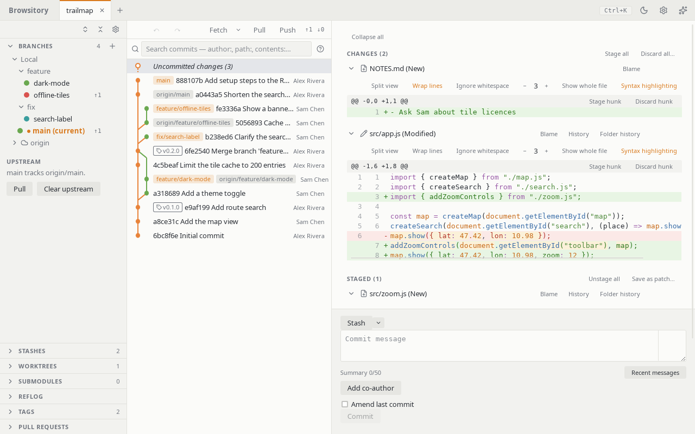

  

<h1 align="center">Browsitory</h1>

A fast, keyboard-friendly Git client for your desktop and for VSCode.

  <a href="https://rene-langer.github.io/browsitory/">User guide</a> ·
  <a href="https://github.com/rene-langer/browsitory/releases/latest">Download</a> ·
  <a href="https://github.com/rene-langer/browsitory/issues">Report a problem</a>

Browsitory shows your history as a commit graph and lets you stage, commit, branch, merge,
rebase, stash and tag without typing Git commands. Open several repositories at once as tabs,
and save a group of them as a **workspace** you open and close in one step.

## Features

- **Commit graph** with branches and tags, commit search, file history, blame, and compares
  between commits, branches or the working tree.
- **Staging by file, hunk or line.** Discard or ignore files, amend, add co-authors, sign
  commits, and run your Git hooks.
- **Branches and remotes:** create, switch, merge, rename and delete branches; fetch, pull and
  push; set upstreams and manage remotes and credentials.
- **Rebase and history rewriting:** an interactive rebase planner, cherry-pick, revert, reset,
  squash and reorder, with conflicts resolved in the app.
- **Undo and redo** for most Git operations, discards included, and a reflog view.
- **Stashes, tags, worktrees and submodules**, each in its own sidebar section.
- **Pull requests** for GitHub and Bitbucket remotes.
- **Command palette** (Ctrl+K, or Cmd+K on macOS) with almost every action, plus keyboard
  shortcuts and keyboard-driven menus.
- **Light and dark theme.**

## Install

**Desktop app** (Windows, macOS, Linux): download the installer for your system from the
[latest release](https://github.com/rene-langer/browsitory/releases/latest): `.exe` or `.msi`
for Windows, `.dmg` for macOS, `.AppImage`, `.deb` or `.rpm` for Linux. The app updates itself.
See [Install Browsitory](docs/guide/install.md) for details.

**VSCode extension** (VSCode 1.134 or newer on desktop; Linux x64, macOS, Windows x64):

- **Visual Studio Marketplace:** search for "Browsitory" in the Extensions view, or run
  `code --install-extension browsitory.browsitory`.
- **Open VSX** (VSCodium, Cursor and others):
  <https://open-vsx.org/extension/browsitory/browsitory>.
- **From a file:** download the `.vsix` for your platform from the
  [releases page](https://github.com/rene-langer/browsitory/releases) and run
  `code --install-extension browsitory-<version>-<platform>.vsix`.

Then run **Browsitory: Open** from VSCode's Command Palette.

## Learn more

The [user guide](https://rene-langer.github.io/browsitory/) explains every feature. You can
also read it here in the repository: [docs/guide/](docs/guide/README.md).

Want to build Browsitory yourself or help out? See [CONTRIBUTING.md](CONTRIBUTING.md).

## Privacy

Browsitory collects no data: no telemetry, no analytics, no crash reports. The desktop app looks
for updates on GitHub; everything else it connects to is a server you chose. The
[privacy notice](docs/guide/privacy.md) lists each connection and the data kept on your computer.

## Licence

Browsitory is MIT-licensed; see [LICENSE](LICENSE). It includes libgit2 (GPL-2.0 with a linking
exception) and other open-source libraries. Their licences are in
[THIRD_PARTY_NOTICES.md](THIRD_PARTY_NOTICES.md), which ships with every installer and
extension package.
