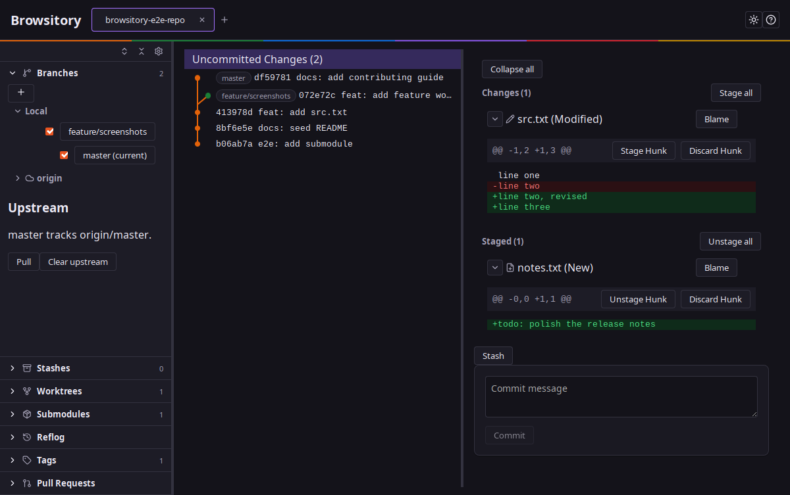
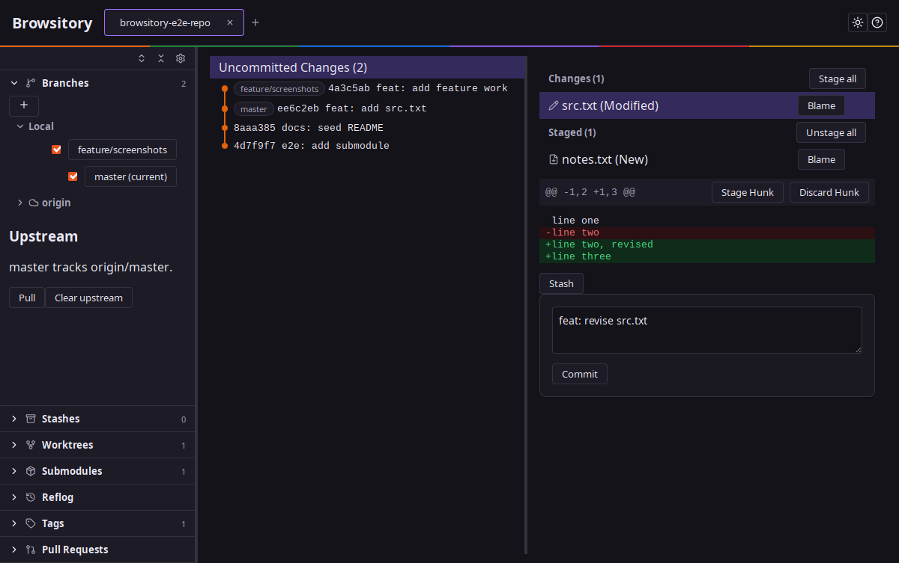
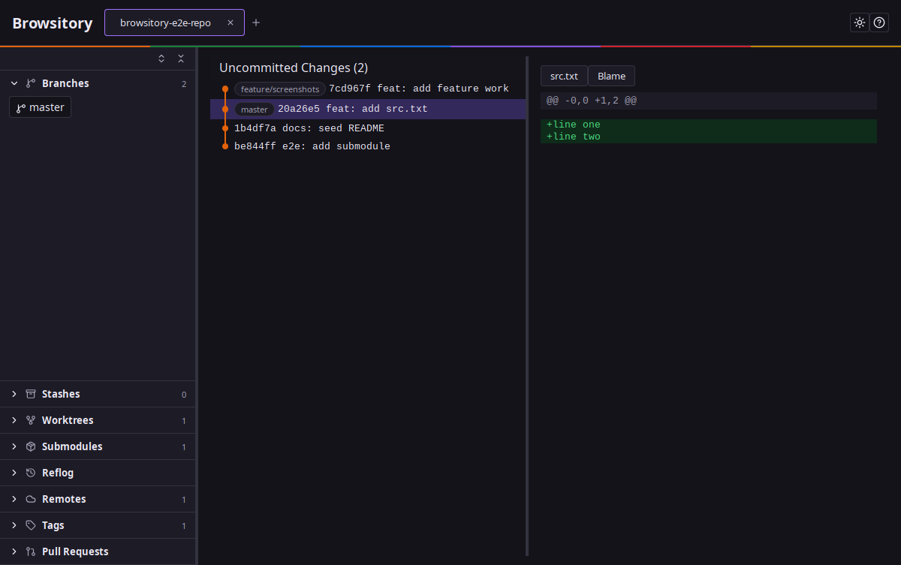
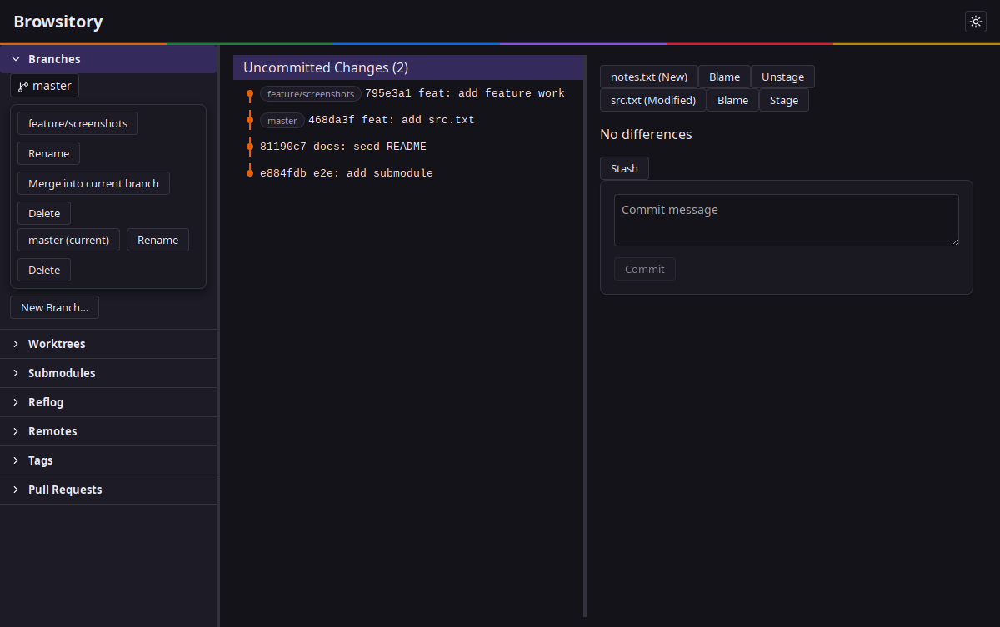
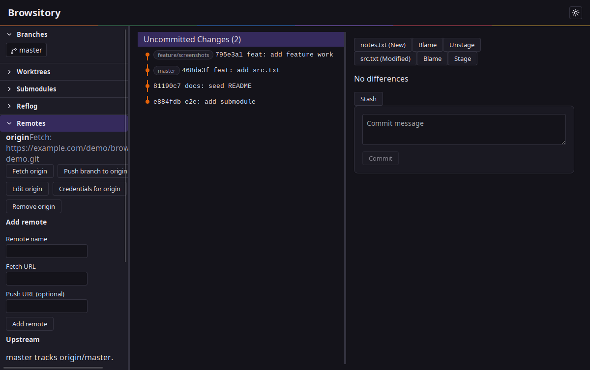
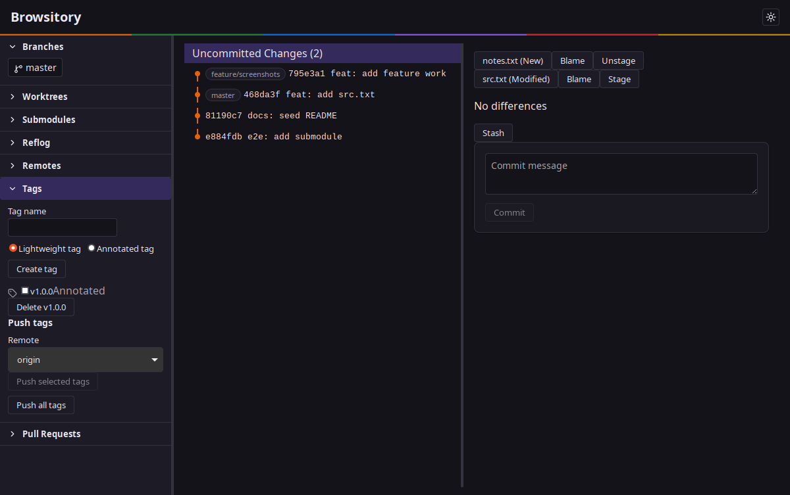
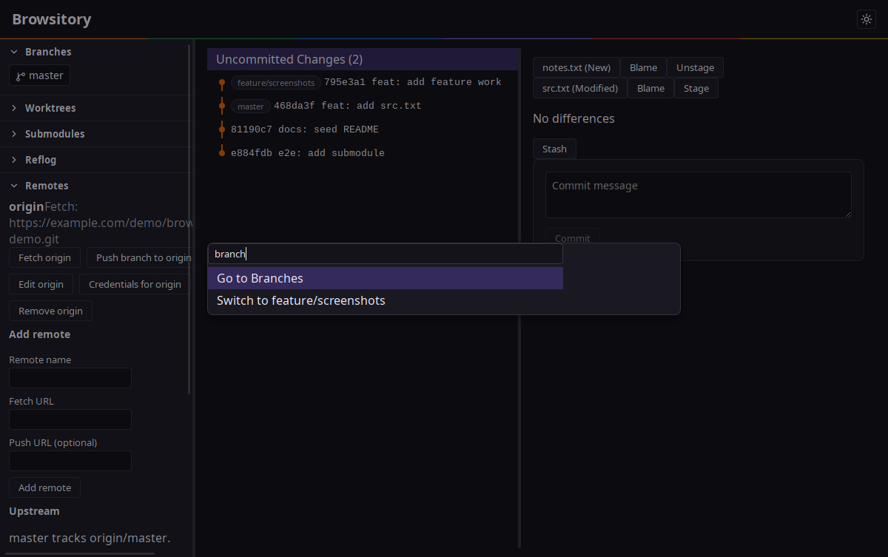

# Browsitory User Guide

A tour of Browsitory's UI and the day-to-day Git workflows it covers.

## Opening a repository

On launch, Browsitory shows a repo picker: pick a folder, or reopen one of your
recently used repositories.

## Cloning and creating repositories

Desktop app only — in VSCode, use VSCode's own **Git: Clone** and **Git: Initialize Repository**.

**Clone…** (repository picker, or the palette's "Clone repository…"):

- **URL** — `https://…`, `ssh://…`, `git@host:org/repo.git`, or a local path / `file://` URL.
- **Parent folder** and **Folder name** — the clone goes into *parent/name*. The name follows
  the URL until you edit it. The parent must be an absolute path (use **Browse…** if unsure). The
  folder must not exist yet, or be empty.
- **Branch** — optional; defaults to the remote's default branch.
- **Include submodules** — on by default. A submodule that can't be fetched doesn't stop the
  clone; the toast says how many failed and the Submodules panel shows them.
- **HTTPS credentials** — for private repositories with an HTTPS (`https://`) URL, enter a
  username and access token. The token is saved to your system keychain, and the remote set to
  use it, **only after the clone succeeds**. SSH URLs use your SSH agent. Don't put the token in
  the URL — Browsitory refuses URLs that contain a password.
  If the keychain write fails, the clone still succeeds and a toast says "Cloned *name*, but the
  token couldn't be saved." — enter the token again later from the remote's **Manage
  credentials** action (right-click the remote in the Branches sidebar).

Progress shows while cloning; **Cancel clone** stops it and removes what was downloaded.

**New repository…** — pick (or create) a folder; Browsitory runs the equivalent of `git init`
there, on your `init.defaultBranch` (or `main`), and opens it. Picking a folder that already
is a repository offers to open it instead.

## Multiple repositories

Every repo you open lands in its own tab at the top of the window, independent
of the others. Only the active tab's view is kept loaded: switching back to a
tab reloads its history and changes, and a half-typed commit message is kept,
but the selected row and expanded diff sections start fresh. Open another via
**+** at the end of the tab bar. Close a tab with its **×** button, **Delete**
on the focused tab, or **Close tab** in the command palette. While a push,
fetch, or similar operation is running in the active tab, that tab can't be
closed until it finishes.
Reopening Browsitory restores every tab you had open, workspace groupings
included.

## Workspaces

A **workspace** is a saved group of repositories under a common root
folder — the multi-repo case most git GUIs don't have an answer for: a
project split across several repos that you always want open together.
From the repo picker, **Open Workspace Root** scans a folder for git repos
and lets you name and save the group; **Open all** reopens every member as
tabs at once, visually grouped in the tab bar under the workspace's name
with a single button to close the whole group together. **Edit** re-scans
the root — so a repo added to the folder later shows up, unchecked, ready
to add — and lets you change which repos are members; **Delete** removes
the saved workspace without touching the repos themselves.

## Overview

Once a repository is open, the window is split into three columns: the
**sidebar** (Branches, Stashes, Worktrees, Submodules, Reflog, Tags, Pull
Requests — Branches is expanded by default, the rest start collapsed), the
**commit graph** (your history, newest first), and the **working-directory /
diff pane** on the right.

Every sidebar section except Branches can be hidden entirely — click the
gear icon at the top of the sidebar to open a popover with a toggle per
section, and tuck away whatever a given project doesn't use.



## Staging and committing

The right-hand pane defaults to your working directory, split into
**Changes** and **Staged** groups — each with a bulk **Stage all**/**Unstage
all** action. Hover a file to reveal its stage/unstage toggle, or use
**Blame** for per-line authorship. Click a file to preview its diff, type a
commit message, and hit **Commit**. **Stash** sets the current changes
aside — expand **Stashes** in the sidebar to get them back.

A rename you staged (`git mv`, or staging both the deletion and the new file) is one **Staged**
row under the new name with "Renamed from …": its diff shows only the edits, an image previews
the old version against the new one, and unstaging it unstages both names. A file moved on disk
but not staged yet shows as deleted plus new, like `git status`.



### Writing the commit message

Below the message, **Summary 42/50** counts the characters of the first line. Past the limit it
turns to a warning color, because many tools cut longer summaries; it never stops a commit. A
faint ruler marks column 72 for wrapping the body, and the field uses a monospace font while the
ruler is shown so the column lines up. Change the limit, the ruler column (both 10 to 200) or
turn the ruler off under **Preferences → Commit message**.

**Add co-author** lists the authors of the last 1,000 commits on the current branch (newest
first, without you); type to filter, or type a new `Name <email>` and press Enter. Each co-author
shows as a chip (× removes it) and is added to the message as a `Co-authored-by: Name <email>`
trailer when you commit, after any trailers the message already ends with and never twice.
The chips stay until the commit lands, so a failed hook keeps them, and **Commit without hooks**
uses them too. They are hidden while a merge, cherry-pick or revert pre-fills the message.

### Resolving conflicts

A merge, cherry-pick, revert, rebase or stash pop that conflicts lists the files as
**Conflicted**. Click one to open the conflict pane:

- For text conflicts, choose **Accept ours**, **Accept theirs** or **Accept both** for each
  conflicting block, then **Save resolution**.
- **Use ours (whole file)** keeps your current branch's version (HEAD) of the whole file and
  **Use theirs (whole file)** takes the incoming version: the commit being merged, cherry-picked
  or reverted, or the stash. During a rebase "ours" is the branch you are rebasing onto and
  "theirs" the commit being replayed. These work for every conflict, including binary files and
  files one side deleted (choosing the deleting side deletes the file). The file keeps the chosen
  side's executable bit. Symlink and submodule conflicts have to be resolved with git.
- **Mark resolved** stages the file as it is on disk, after you edited it yourself or in another
  tool. If it still contains `<<<<<<<` / `>>>>>>>` conflict markers, Browsitory asks before
  staging it. A deleted file is marked resolved as deleted.

### Staging individual lines

In a diff, select lines by clicking one, Shift+clicking to extend, Ctrl/Cmd+clicking to add
or remove one, or dragging across several. Then use **Stage lines**, **Unstage lines** or
**Discard lines** in the hunk header. With the keyboard, `↑`/`↓` move a line cursor inside the
active hunk and select that line, `Shift+↑`/`Shift+↓` extend the selection, and `[` / `]` jump
to the previous or next hunk (which clears the selection). `s` stages or unstages and `d` `d`
discards the selection, or the whole hunk when nothing is selected.

If the file changed since its diff was shown (for example you edited it in another editor),
line actions don't run; the diff refreshes so you can select again. Discarding a whole hunk of
an untracked file empties the file rather than deleting it. Staging a whole hunk doesn't stage a
file's mode change (such as the executable bit); stage the whole file for that.

### Discarding and ignoring files

Open a file's **⋯** menu, right-click the file header, or press Shift+F10 (or the Menu key)
with the file row focused, for **Discard changes…**. Staged files don't offer discard; unstage them first. A confirmation dialog
appears. A discard can be reverted with **Undo** (see [Undo and redo](#undo-and-redo)) unless the
file is changed again afterwards. **Discard all…** next to **Stage all** discards
the unstaged changes of exactly the files its confirmation lists. It deletes untracked files
and skips conflicted ones. Folders, such as an untracked nested repository, are never deleted;
any file that couldn't be discarded is named in an error after the rest are done. Discarding
never writes or deletes outside the repository, including through a symlinked folder. If a
tracked file was replaced by a symbolic link, discarding removes the link and restores the file
(the link's target is never touched), like git; reset, undo/redo, aborting a merge or rebase and
resolving a conflict do the same.

For untracked files the menu also offers ignore items. Each appends a pattern to the
repository's `.gitignore` (creating it if needed; a `.gitignore` that is a symlink is left
alone and reported). **Ignore file** is always offered.
**Ignore all \*.ext** appears only when the file name has an extension. **Ignore folder
⟨folder⟩/** appears only when the file is in a subfolder.

### Signing commits

Browsitory signs commits the way `git commit` does, from your git config. It has no setting of
its own:

- `commit.gpgSign = true` turns signing on.
- `gpg.format` picks `openpgp` (default, uses `gpg`) or `ssh` (uses `ssh-keygen`). `x509` is not
  supported.
- `user.signingKey` picks the key. For gpg it defaults to your committer identity. For SSH it is
  required: either a key file path or a literal public key (`key::ssh-ed25519 …`) whose private
  key is in your ssh-agent.
- Program overrides: for OpenPGP, `gpg.openpgp.program` wins over `gpg.program`; `gpg.program`
  applies to OpenPGP only. For SSH use `gpg.ssh.program`.

If you see "Signing program 'gpg' was not found", Browsitory may not have inherited your shell's
`PATH` (for example when launched from the macOS Dock, or with Git for Windows' gpg). Set
`gpg.program` to an absolute path.

Passphrases come from gpg-agent's pinentry or from ssh-agent. Browsitory cannot prompt in a
terminal. If signing fails, no commit is created and the signer's error is shown. While the
signing program runs, the commit box says "Waiting for the signing program…" with **Cancel**;
after 2 minutes Browsitory stops it and says so (unlock your key and commit again). Checking a
signature in the history gives up after 30 seconds and shows "Signature could not be checked".

Selecting a signed commit shows a **Signature** row in the commit details:

- **Good signature**: valid, from a trusted key (gpg) or a signer listed in
  `gpg.ssh.allowedSignersFile` (SSH).
- **Valid signature, signer not trusted**: cryptographically valid, but the key is not trusted
  or not listed.
- **Signed with an unknown key**: the public key is not in your keyring.
- **Signature expired** / **Signed with an expired key** / **Signed with a revoked key**.
- **Bad signature**: the commit does not match its signature.
- **Signature could not be checked**: for example gpg is not installed.

### Hooks

Browsitory runs your repository's client-side git hooks the way git does:

| Hook | Runs when you… |
|---|---|
| `pre-commit`, `prepare-commit-msg`, `commit-msg`, `post-commit` | commit or amend |
| `pre-push` | push a branch, force push, push tags, **Push to…**, or delete a remote branch |
| `post-checkout` | switch branches or check out a commit |
| `post-merge` | merge a branch (also a squash merge) or pull with a fast-forward |

Hooks come from `core.hooksPath` (a relative path is relative to the repository root) or
`.git/hooks`. As in git, this includes a `core.hooksPath` set in the repository's own config;
only open repositories you trust. (External diff and merge tools are stricter, see
[Diff and merge tools](#diff-and-merge-tools).) They run in the repository root with the same arguments and standard input git
gives them, and like git Browsitory does not set `GIT_DIR`, so a hook can `cd` into a
subdirectory (for example `cd frontend && npx lint-staged`) and run git there. On macOS
and Linux a hook must be executable. Hook managers such as husky, pre-commit or lefthook work
through the hook scripts they install. Files a `pre-commit` hook stages (formatters,
lint-staged) are part of the commit. `pre-push` runs after Browsitory has contacted the remote
and before anything is sent, so it sees the remote's current commits, as in git.

A failing `pre-commit`, `commit-msg` or `pre-push` stops the commit or push. A dialog shows the
hook's output; **Commit without hooks**, **Amend without hooks** or **Push without hooks**
retries with those hooks skipped (`--no-verify`). A failing `prepare-commit-msg` cannot be
skipped, so its dialog only has **Close**. Close the dialog and **Show hook output…** in the
error banner brings it back. Your commit message stays in the box until a commit succeeds.
Failures of `post-commit`, `post-checkout` and `post-merge` are ignored, as in git.

To skip hooks up front, tick **Skip hooks** under the commit message (shown only when a
`pre-commit` or `commit-msg` hook is installed) or run "Skip hooks for the next commit" from the palette. It applies to the
next commit or amend only.

While a commit hook runs, "Running pre-commit hook…" shows under the commit message with
**Cancel**; a running `pre-push` shows in the transfer panel, whose Cancel stops it. Browsitory
stops any hook after 10 minutes. Other actions on the repository wait while a hook runs.

Hooks cannot ask you anything: their input is empty (or, for `pre-push`, the list of refs).
If you started Browsitory from a terminal, a hook that tries to read from that terminal
(`/dev/tty`) is paused by the system and sits there until you press Cancel or the 10 minutes
run out. If a hook leaves a background process running that keeps its output open, Browsitory
waits up to 2 more seconds for output after the hook exits, then carries on.

Like signing, apps started from the macOS Dock may not see your shell's `PATH`. If a hook cannot
find a tool, use absolute paths in the hook or extend `PATH` inside it.

On Windows, hooks run with the `sh.exe` that comes with Git for Windows (found next to `git.exe`
or on `PATH`). Without it, a `pre-commit`, `commit-msg` or `pre-push` hook fails with a message
saying so (use the "without hooks" retry to go ahead), and other hooks are skipped. Cancel and
the time limit stop the hook's shell, but not programs it started.

Rebase, cherry-pick, revert, undo/redo, stash, worktree creation and clone run no hooks.
Finishing a paused merge, cherry-pick or revert with Commit runs the commit hooks; **Continue**
on a multi-commit cherry-pick or revert does not.

## Browsing history and diffs

Click any commit in the graph to see the files it touched; click a file to
view its diff, or **Blame** to see per-line authorship. Commits from every
local branch are shown, each tagged with the branches that point at it, with
the author and date on each row (they hide when the pane is narrow). Selecting
a commit shows its full message, author, date, full SHA (with a **Copy**
button) and parents above the file list; click a parent to jump to it. The
graph loads the latest 300 commits; choose **Load more** at the bottom (or
keep arrowing past the last row) to fetch the next page.

The bar above the graph has **Fetch**, **Pull** and **Push** buttons for the
current branch's upstream, with ahead/behind counts (for example `↑2 ↓1`)
based on the last fetch.



### Image previews

A changed PNG, JPEG, GIF, WebP or SVG file shows the old and new image side by side (**Before**
and **After**) instead of a text diff, with each image's size in pixels and file size, on a
checkerboard so transparency shows. A new file shows **Added** on the left and a deleted one
**Deleted** on the right. This works in the working tree, commits, stashes and compares. Each
side is previewed up to 20 MB; a bigger one says "Too large to preview". The image type is
checked from the file's content, not its name, and a file that isn't really one of these images
says "Can't display this image". Images are only shown as pictures, so an SVG can never run a
script. An SVG is text too: **Show text diff** switches to its diff (and back with **Show
image**). A conflicted image opens the conflict pane, like any conflict.

### Diff options

The diff toolbar has three controls, remembered across sessions: **Ignore whitespace**,
**Context lines** (0 to 20) and **Syntax highlighting**. While whitespace is ignored, partial
staging (lines and hunks) is unavailable in the working tree and a hint says so; staging and
unstaging whole files still works. Right after you change an option, hunk and line actions
return once the diff has reloaded with it. Highlighting covers common languages and is skipped
when a file's diff has more than 2,000 lines in total across its hunks. The command palette has
an entry for each option.

## File history

Click **History** in a file's header — in the working tree (any tracked file) or in a commit's
file list — or run **File history of current file** from the command palette. The commit list
is replaced by the commits that changed that file, newest first, starting from the checked-out
commit (HEAD). The graph's branch selection does not apply here.

Renames are followed: commits before a rename list the file under its old name, and the commit
that renamed it is marked "renamed from …". Its diff shows the real edits, not a whole-file add.
A merge is listed only when its version of the file differs from every parent.

Selecting a commit shows only that file's diff; **Show all N files** shows the whole commit.
Use ↑/↓ (or j/k) to move, **Load more** for older changes, and **×** or Esc to return to the
full history with your previous selection.

## Searching commits

The search field sits above the commit graph. Click it, press **Ctrl+F** (**Cmd+F** on macOS)
while the commit list has focus, or run **Search commits** from the command palette. Once you
stop typing, the graph is replaced by the matching commits and the first match is selected.
Press ↓ in the field to move into the results.

| Syntax | Meaning |
|---|---|
| `word` | Message contains it, or SHA starts with it |
| `"two words"` | Exact phrase |
| `author:NAME` | Author name or email |
| `committer:NAME` | Committer name or email |
| `message:TEXT` | Anywhere in the full message |
| `commit:SHA` | SHA starts with it |
| `path:PATTERN` | Changes a matching path (`src/`, `*.md`) |
| `contents:TEXT` | An added or removed line contains it |
| `after:YYYY-MM-DD` | Committed on or after that day |
| `before:YYYY-MM-DD` | Committed on or before that day |
| `branch:NAME` | Only commits reachable from NAME |

- Terms combine with AND, and case is ignored except in `path:`.
- Quote text with spaces or a colon (`"fix: crash"`). An unquoted `word:` that is not one of the
  keys above is an error, so a conventional-commit prefix like `fix:` needs quotes.
- Dates are whole days in the commit's own timezone, inclusive.
- `path:` and `contents:` look at what a commit changed compared with its first parent, so a
  merge counts as the changes it brought in.
- Without `branch:`, the search covers the branches the graph shows.
- Results load 100 at a time, and "Scanned N commits…" shows progress on large histories.
- Selecting a result shows its diff as usual.
- Esc or × goes back to the graph and the previous selection.
- File history opened from a result returns to the results when closed.

## Comparing commits and branches

Compares are read-only and replace the diff pane until you click **×** or click a row (a
commit, a stash, a search result), including the one already selected.

- **Two commits:** select one commit, then Ctrl-click (Cmd-click on macOS) a second one, and
  choose **Compare these commits** in the bar under the graph or in the right-click
  menu. The older commit (lower in the graph) is on the left: the header reads
  `Comparing older..newer`. **Swap** reverses it. The commits do not need to be related; this
  is `git diff A B`.
- **A branch since it diverged:** right-click a local branch other than the current one, or a
  remote-tracking branch, and choose **Compare with current branch** (**Compare with HEAD**
  when no branch is checked out). It shows what the branch changed since its merge base with
  HEAD (`git diff HEAD...branch`), so commits only on your branch do not appear.
- **A commit against the working tree:** right-click a commit and choose **Diff against working
  tree**. Staged, unstaged and untracked changes are all included, and the view follows edits on
  disk.

A file git detects as renamed is listed once with "Renamed from …", and its diff shows only
the edits. In a working-tree compare that holds for renames git already tracks (`git mv`, or a
move you staged); a file moved on disk but not yet added shows as a deletion plus a new
untracked file. Each
file has **Blame** (at the newer side, or at HEAD for the working tree) and **History**. With
more than 50 files, every file starts collapsed; use **Expand all**.

## Branches and remotes

**Branches** is a single tree: a **Local** folder holding your local
branches, and one folder per remote holding that remote's branches (fetched
lazily the first time you expand it). Double-click a local branch, or choose
**Checkout** from its context menu, to switch to it;
right-click a branch, a remote folder, or a remote branch to bring up its
actions — checkout, rename, delete, merge, or **Push to…** a local branch; checkout, set as
upstream, or **Delete <remote>/<branch>…** a remote branch; fetch, push, edit, manage
credentials for, or remove a remote. The **+** button in the section header opens **New branch…** or
**Add remote…**. Creating a branch from a specific commit, or starting a
rebase onto one, is available from that commit's row in the graph. The
current branch's upstream status, a **Pull** button, and **Set upstream…**
live at the bottom of the section.

**From the keyboard.** Tab to a branch, a remote branch or a remote folder and press the Menu key
or Shift+F10 (Fn+Shift+F10 on most Mac keyboards), or use its **…** button, to open the same menu.
In any menu, ↑/↓, Home/End or a letter move between items, Enter or Space runs one, Esc closes
the menu and returns to the row, and Tab closes it and moves on. The command palette also has
**Edit remote …**, **Manage credentials for …** and **Remove remote …** for each remote; they
open the same dialogs (Remove still asks first), even while the Branches section is collapsed.

**Publishing a branch.** **Push to…** pushes any local branch to a remote under any name.
The dialog asks for the remote (the branch's upstream remote, else `origin`), the remote
branch name (the local name by default) and **Set as upstream**, which is on by default for
a branch that has no upstream yet. The sync bar's **Push** opens the same dialog when the
current branch has no upstream, so a new branch is published in one step.

**Where Push goes** follows your git `push.default` (unset means `simple`). With `simple`, a
branch whose upstream has a different name — say `feat`, created from `origin/main` and so
tracking it — is not pushed onto `main`: **Push** opens **Push to…** with that remote and the
branch's own name instead. Set `push.default=upstream` to push to the upstream branch, or
`current` to push to the same name. With `nothing`, Push always asks. Force push follows the same
rule.

**Ahead/behind.** A local branch with an upstream shows `↑n` (commits to push) and `↓m`
(commits to pull) next to its name, counted against the last fetch. Nothing is shown when the
branch is in sync, or when its upstream has never been fetched.

**Fetching every remote.** The chevron next to **Fetch** opens **Fetch all remotes** and a
**Prune** toggle. Pruning removes remote-tracking branches whose branch was deleted on the
remote. The toggle is remembered per repository; until you set it, your git config
(`remote.<name>.prune`, then `fetch.prune`) decides per remote. If a remote fails during Fetch
all (unreachable, missing credentials), the others are still fetched and the error names the
ones that failed.

**Merge options.** **Merge into current branch…** opens a dialog naming both branches. Choose
**Fast-forward if possible** (move the branch when nothing diverged, else create a merge
commit), **Always create a merge commit** (even when a fast-forward was possible; the commit box
is pre-filled and the commit gets two parents), or **Fast-forward only** (refuse, changing
nothing, when the branches have diverged). **Squash** stages the combined changes of the branch
without committing and without recording a merge: HEAD does not move, the commit box is
pre-filled with the squashed commits' messages, and the commit you make has a single parent.
**Undo** reverts a squash. The dialog remembers your last choice per repository; until then it
follows your git `merge.ff` (`false` = always a merge commit, `only` = fast-forward only). The
**Merge** button of the "Pull has diverged" prompt always allows a fast-forward and does not ask.

**Deleting a remote branch** deletes it on the remote and removes its remote-tracking branch.
Like every network operation, it can't be undone with **Undo**. Local branches that tracked it
keep their upstream setting (git shows such an upstream as "gone").





## Stashes

**Stash** in the commit dock sets every change aside, untracked files included. Its chevron
opens **Stash all** and **Stash…**, a dialog with an optional message, **Keep staged changes**
(stash them but also leave them staged) and **Include untracked files** (on by default).
**Stash file…** in a changed file's menu (staged or not) opens the same dialog for just that
file; every other change stays where it is, and "Restore staged changes" later restages only
that file. For an untracked file, untracked files are always included. One file at a time: the
change lists have no multi-select. A file inside a symlinked folder can't be stashed on its own.
If a tracked file was replaced by a symbolic link, stashing keeps the link in the stash and puts
the file back; while a symbolic link replaces a tracked folder, **Stash all** refuses (move the
link away first). So do switching branches, merging, cherry-picking, reverting, rebasing,
applying a stash and pulling, which could otherwise create files through the link — also when
nothing tracked the link's name but the operation would create files below it. The message names
the link: "'d' is a symbolic link where the repository has a folder. Remove or rename it first."
Staging or discarding a file below such a link refuses too ("'d/f' is beyond a symbolic link."),
like git; **Stage all** stages the link itself in place of the folder.

Expand **Stashes** to see everything set aside. Click a stash to see what it holds: **Changes**
(diffed against the commit it was made on) and, if it took any, **Untracked** files. From there
or from the panel you can **Apply** it (keep the stash), **Pop** it (apply, then drop it) or
**Drop…** it. **Restore staged changes** (on by default) brings back staged work as staged;
turn it off to get everything back unstaged.

Apply and Pop need nothing staged and no unresolved conflicts; the buttons are disabled with the
reason until then. A stash that conflicts with your current files applies anyway and opens the
files in the conflict pane; a conflicting **Pop** keeps the stash, so drop it yourself once the
files are resolved. If the stash list changed since you looked (another tool stashed or
dropped), Apply, Pop and Drop stop and ask you to refresh. Dropping asks for confirmation first, since it can't be undone, and stash
operations are not part of **Undo**.

## Tags

Expand **Tags** to create lightweight or annotated tags, delete local ones,
and push a selection (or all of them) to a remote.

Tags also appear as outlined badges (with a tag icon) on commit rows in the graph, file history
and search results. Right-click a badge in the graph to push that tag to a remote, check out its
commit (detached), or delete the local tag. The Tags panel remains the keyboard path for pushing
and deleting tags; **Check out tag … (detached)** in the command palette checks out a tag's
commit.



## Worktrees and submodules

**Worktrees** creates and removes linked worktrees, and opens one directly
in Browsitory. **Submodules** initializes and updates submodules, including
recursively.

## Reflog

**Reflog** lists recent HEAD movements per reference and can restore a
branch to an earlier entry — useful for recovering from a bad reset or
rebase.

## Rebase

Starting a rebase (from a branch or a specific commit) opens the rebase
planner as an overlay, where you can reorder/pick/squash/drop commits
before running it. Conflicts, once they happen, are resolved inline in the
diff pane; a paused rebase shows its progress and lets you continue or
abort.

**Selecting several commits.** Ctrl/Cmd+click (mouse) toggles individual commits, which is how you
select non-adjacent ones; Shift+click or Shift+Arrow selects a range. With two or more selected, a
toolbar under the graph (and the right-click menu) offers **Interactive rebase…**, **Squash**,
**Fixup** and **Drop**. Each opens the rebase planner, based on the parent of the oldest selected
commit and listing every commit from there to the current HEAD. The selected commits are pre-marked
with the chosen action; for Interactive rebase… they are listed as **Pick**, but are still checked
against the branch history. With Squash or Fixup the oldest selected commit stays **Pick** and the
rest fold into it. Squash and Fixup are available only for commits that sit next to each other;
Drop and Interactive rebase… work for any selection. Selections that include a merge commit or a
root commit, or commits that aren't on the current branch, can't be rebased. Esc collapses a
selection back to one commit.

## Rewriting and moving commits

Right-click a commit in the graph:

- **Cherry-pick** applies that commit on top of your current branch (not available on the
  current HEAD commit). If it conflicts, the status strip shows **Cherry-picking**, conflicts
  resolve exactly like a merge, and **Commit** finishes it. **Abort cherry-pick** undoes it and
  keeps unrelated unstaged edits. A pick is refused if it would overwrite unstaged edits or if
  changes are staged. Picking a commit whose changes are already on the branch reports
  "Nothing to apply — those changes are already on this branch." On a merge commit the item
  reads **Cherry-pick…** and asks which parent to apply it against: parent 1 is usually the
  branch that was merged into, so picking against it applies what the merge brought in.
- **Revert** commits the inverse of that commit, with the same conflict flow (**Reverting**,
  **Abort revert**). On a merge commit, **Revert…** asks for the parent to keep (parent 1 undoes
  what the merge brought in), and the message names it like `git revert -m` does.
- **Checkout (detached)** checks the commit out without a branch. The sync bar shows
  **HEAD detached at …** and push and pull are disabled until you check out a branch.
- **Reset ⟨branch⟩ to here…** moves your branch to that commit. **Soft** keeps your changes
  staged, **Mixed** (the default) keeps them unstaged, **Hard** discards changes to tracked files;
  untracked files are kept. Hard asks for a second confirmation (**Reset hard**). Not available
  on a detached HEAD.
- **Edit commit message…** appears on the latest commit only. It opens the amend box with that
  commit's message filled in and the cursor in the message field.

**Amend last commit.** Tick **Amend last commit** under the commit message. The message fills
with the last commit's, and the **Commit** button becomes **Amend**: anything staged is folded
into that commit (or just reword it). If that commit is already on the upstream, a warning reads
"Already pushed — you'll need to force push." Whatever you had half-typed is kept and comes back
when you untick amend or after a successful amend.
An **Author** field shows the commit's author as `Name <email>`. Leave it as it is (or empty) to
keep the author, or change it to give the commit a different author; the original author date is
kept and you stay the committer. It must have the form `Name <email>`. Co-authors work here too;
amend starts without the chips you added for your next commit and gives them back afterwards.

**Force push.** When a push is rejected because the remote has commits you don't, the error
offers **Force push (with lease)…**. The command palette (Remotes group) has it too; it is hidden
on a detached HEAD or when the branch has no upstream. It always asks for confirmation. The push
is refused if the remote branch changed since your last fetch ("⟨remote⟩/⟨branch⟩ changed since
your last fetch. Fetch and review before force pushing."). Like `git push --force-with-lease`, a
fetch between reviewing and pushing refreshes the lease, so review the remote branch after your
last fetch, not before.

**Several commits.** Select commits with Ctrl/Cmd+click or Shift+click, then **Cherry-pick N
commits** or **Revert N commits** (in the right-click menu and the bar under the graph). The order
you select them in doesn't matter: cherry-picks apply oldest first, reverts newest first (like
`git revert A..B`). Each commit keeps its own message and author. A commit whose changes are
already on the branch is skipped, and the result says so ("Cherry-picked 2 commits, skipped 1
with no changes"). Reverting a revert is called "Reapply …", as in git. Merge commits have to be picked one at a time, so the actions are disabled
when the selection holds one.

A conflict pauses the sequence: the status strip shows "Cherry-picking 2/5" and the commit area
shows **Continue cherry-pick** / **Abort cherry-pick** instead of the message box. Resolve the
conflicts (see [Resolving conflicts](#resolving-conflicts)), then **Continue**; it commits the
resolved step and goes on. If you resolve a step so that nothing is left to commit (for example
**Use ours (whole file)** on its only change), that step is skipped. A sequence that stops for
another reason (say an untracked file is in the way) also shows **Continue**, which retries the
step. The paused sequence is kept on disk, so it is still there after you close and reopen the
app. While it is paused, other cherry-picks, merges, rebases, commits, amend, reset, checkout,
branch switching, pull and stash apply/pop are unavailable.

If you finish a conflicted step yourself in a terminal (`git commit` after resolving),
**Continue** recognises it when it is exactly that step: one commit on top of where the sequence
stopped, with the picked commit's author (for a cherry-pick) or git's "This reverts commit …"
message (for a revert). Any other commit, or any commit after a stop that wasn't a conflict,
means HEAD moved, and Continue refuses.

**Abort** puts the branch back where it was before the first commit was applied, keeping
unrelated uncommitted edits. If HEAD was moved elsewhere in the meantime (for example by a commit,
reset or branch switch in a terminal), Abort only ends the sequence and leaves HEAD and every
branch alone, and says so.
Continue refuses in that case. A whole sequence is one **Undo** step; an aborted one leaves
nothing to undo. Like a single cherry-pick, the steps of a sequence (including the one
**Continue** commits) run no commit hooks.

The palette also has commands to cherry-pick, revert, check out and reset to the selected commit,
and to amend the last commit (where the commit menu offers them), plus **Continue cherry-pick** /
**Abort cherry-pick** (or revert) while a sequence is paused.

## Pull requests

For GitHub and Bitbucket remotes, expand **Pull Requests** to save a
personal access token, list existing pull requests, and open a create form
targeting a source/target branch.

## Undo and redo

**Ctrl/Cmd+Z** undoes the last Git operation in the active repository and
**Ctrl/Cmd+Shift+Z** (or Ctrl+Y) redoes it. The undo/redo buttons next to Fetch/Pull/Push, the
command palette, and the toast's Undo/Redo button do the same; each names the operation it
will act on. Undo covers staging, commits, amend, reset, branch and tag changes, checkout,
cherry-pick, revert, merge, rebase, pull and every discard, so discarded changes are
recoverable. Up to 50 steps are kept, across restarts.

Undo refuses, instead of overwriting, when the repository changed since the operation, or
when it would delete, move or switch to a branch that is checked out in another worktree; the
reflog stays available for those cases.

Typing in a text field keeps that field's own undo. In the VSCode extension, use the toolbar
buttons or the command palette if Ctrl/Cmd+Z is taken by VSCode.

Tools that show all refs (`git log --all`, gitk) show a "browsitory undo anchor" commit; it
keeps undoable objects from being garbage-collected.

## External tools

### Opening files

Every changed file, every file of a commit and every file in a compare has a "…" button and a
right-click menu with **Open in editor**, **Reveal in file manager** and **Open in diff tool**
(**Open in merge tool** for a conflicted file). The palette has "Open current file in editor"
and "Open current file in diff tool".

Set your editor in **Preferences** (the gear button in the header, or "Preferences…" in the
palette). The command is split into words the way a shell would, but never run through a
shell, and these placeholders are replaced inside each word:

- `{file}`: the file's full path (added at the end when the command has no `{file}`)
- `{line}`: the first changed line, or 1
- `{dir}`: the repository's root folder

Examples: `code --goto {file}:{line}`, `subl {file}:{line}`, or on Windows
`"C:\Program Files\Sublime Text\subl.exe" {file}:{line}`.

Without an editor setting, the file opens with your system's default app. Files the system
might run instead of open are refused on every platform (a Windows installer can still run on
Linux or macOS through Wine): programs and installers (`.exe`, `.msi`, …), scripts (`.sh`,
`.py`, `.bat`, `.ps1`, …), shortcuts and launchers (`.lnk`, `.desktop`, `.app`, …), files with
the execute bit on macOS and Linux, and files whose contents start like a script, program,
installer or desktop launcher. Set an editor to open those.

Don't wrap an editor or terminal command in `sh -c '…'` or `cmd /c …`: Browsitory deliberately
passes the file path as one plain argument, and a shell would read shell syntax in file names
(a repository can contain a file called `$(rm -rf ~).txt`). Commands are checked when you save
them, and one with an unclosed quote is refused.

Apps started from the macOS Dock (or a Linux desktop launcher) may not see your shell's `PATH`.
If an editor, terminal or diff tool isn't found, use its absolute path, for example
`/usr/local/bin/code --goto {file}:{line}` or `git config --global difftool.meld.path
/opt/homebrew/bin/meld`.

### Terminal

Right-click a repository tab (or focus it and press Shift+F10 or the Menu key) for **Open
terminal here** and **Reveal repository**; both are also in the palette. The terminal starts
in the repository's root folder. Without a terminal setting Browsitory uses:

- macOS: Terminal.app
- Windows: Windows Terminal (`wt`), else a `cmd` window
- Linux: `$TERMINAL`, else the first of `x-terminal-emulator`, GNOME Terminal, Konsole, Xfce
  Terminal, Alacritty, kitty and xterm that is installed

A terminal command in Preferences can use `{dir}`, for example `kitty --directory {dir}` or
`wezterm start --cwd {dir}`.

### Diff and merge tools

Browsitory uses the diff and merge tools from your git config, like `git difftool` and `git
mergetool`:

```sh
git config --global diff.tool meld
git config --global merge.tool meld
```

Without `diff.tool`, the diff tool falls back to `merge.tool`. These work without more setup:
`meld`, `kdiff3`, `bc` / `bc3` / `bc4` (Beyond Compare), `p4merge`, `vscode` and `winmerge`.
Point one at a program that is not on your `PATH` with `difftool.<name>.path` (or
`mergetool.<name>.path`). Any other tool needs a command, which runs through `sh` with the
`$LOCAL`, `$REMOTE`, `$MERGED` and `$BASE` variables, exactly as in git:

```sh
git config --global difftool.mytool.cmd 'mytool "$LOCAL" "$REMOTE"'
```

The command must wait until its window closes (for example `code --wait`), as with `git
difftool`. Terminal tools such as `vimdiff` are not supported, since Browsitory has no terminal
to run them in; give them a `cmd` that opens a terminal window if you want them anyway.
**Preferences** shows which tools Browsitory found and where they were set.

Browsitory only reads tool settings from your own git config (global, XDG or system), never
from a repository's `.git/config`: a repository you downloaded or share with others can't make
Browsitory run a command when you click a menu item. If a repository sets one, Preferences and
the error message say so. Hooks are different: they keep git's behaviour, including a
`core.hooksPath` set in the repository's own config (see [Hooks](#hooks)), because running a
repository's hooks is what git itself does on every commit and push.

What the tool compares:

- an unstaged change: the staged (index) version against the file in your working tree, which
  you can edit in the tool
- a staged change: the last commit against the staged version (the old name for a staged
  rename)
- a commit's file: the commit's first parent against the commit (the old name for a rename)
- a compare: the left side against the right side (or the working tree file)

A missing side (a new or deleted file) is an empty file. The other sides are temporary copies,
removed when the tool closes. They hold the bytes exactly as git stores them: line-ending
conversion (`core.autocrlf`, `text`/`eol` attributes), `ident` and filter drivers (Git LFS, …)
are not applied, so with `core.autocrlf=true` on Windows every line can look changed against the
working tree file. The VSCode diff and merge editors show the same stored bytes.

### Resolving with a merge tool

**Open in merge tool** on a conflicted file opens your tool with your version (`LOCAL`), the
incoming version (`REMOTE`), their common ancestor (`BASE`) and the working tree file
(`MERGED`) to save the result to. Other actions keep working while the tool is open. When it
closes, the file shows "The merge tool finished." or, when the tool reported no resolution, "The
merge tool closed without resolving the conflict." With `mergetool.<name>.trustExitCode` set,
the tool's exit code decides; otherwise any change to the file counts as finished. Both notices
offer **Mark resolved**. **Mark resolved**
stages the file; if it still contains `<<<<<<<` or `>>>>>>>` lines, Browsitory asks first.
No `.orig` backup is written.

### In VSCode

In the VSCode extension, everything opens in VSCode itself: **Open in editor** opens the file
at the line, **Open in diff tool** opens VSCode's diff view, **Open in merge tool** opens
VSCode's merge editor (Browsitory can't tell when you are done there, so it shows no
**Mark resolved** notice: save the result, then stage the file from VSCode's merge editor or
Source Control view; Browsitory picks the change up on its next refresh), **Open terminal here** opens an integrated terminal, and
**Reveal** uses "Reveal in File Explorer/Finder". The editor and terminal settings and your git
tools are not used there.

## Command palette

Press **Ctrl+K** (or **Cmd+K** on macOS) anywhere to open the command
palette: a fuzzy-searchable list of every action above, ranked by recent
use.

Context menus work from the keyboard too: the Menu key or Shift+F10 opens the menu of the
focused branch, remote, changed file, commit or tab. Press **?** for the full list of shortcuts.



## Diagnosing a failure

Browsitory writes a rotated failure log (keeping the 5 most recent files) to the OS log
directory, so a bug report doesn't require a live dev session to reproduce. Attach the
newest file there to a bug report:

- **Linux:** `~/.local/share/com.browsitory.browsitory/logs`
- **macOS:** `~/Library/Logs/com.browsitory.Browsitory`
- **Windows:** `%APPDATA%\com.browsitory.Browsitory\logs`
