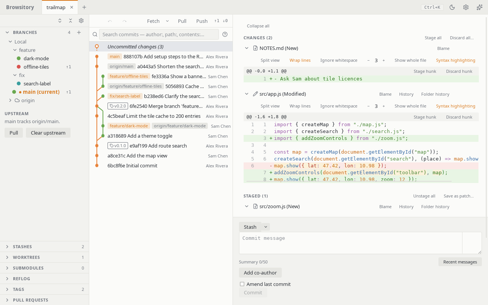

# Browsitory user guide

Browsitory is a Git client for your desktop and for VSCode. It shows your history as a commit
graph and lets you stage, commit, branch, merge, rebase, stash and tag, with undo for most of
it. Open several repositories as tabs, and save groups of them as workspaces.

## Get started

1. [Install Browsitory](install.md): the desktop app, or the VSCode extension.
2. [Open, clone or create a repository](opening-repositories.md).
3. Get to know [the main window](main-window.md).
4. Press **Ctrl+K** (**Cmd+K** on macOS) for the [command palette](command-palette.md), and
   **?** for the keyboard shortcuts.

## Topics

**Repositories**

- [Multiple repositories](tabs.md)
- [Workspaces](workspaces.md)

**Everyday work**

- [Staging and committing](staging-and-committing.md)
- [Resolving conflicts](conflicts.md)
- [History and diffs](history.md)
- [File history](file-history.md)
- [Files at a commit](files-at-a-commit.md)
- [Searching commits](search.md)
- [Comparing commits and branches](compare.md)
- [Patches and partial reverts](patches.md)
- [Undo and redo](undo-redo.md)

**Branches and sharing**

- [Branches and remotes](branches-and-remotes.md)
- [Pull requests](pull-requests.md)
- [Tags](tags.md)
- [Stashes](stashes.md)

**Changing history**

- [Rebase](rebase.md)
- [Rewriting and moving commits](rewriting-commits.md)
- [Reflog](reflog.md)

**More**

- [Worktrees and submodules](worktrees-and-submodules.md)
- [Signing commits](signing.md)
- [Hooks](hooks.md)
- [External tools](external-tools.md)
- [Command palette and shortcuts](command-palette.md)
- [Troubleshooting](troubleshooting.md)

Found a problem, or a page that's wrong? Report it on
[GitHub](https://github.com/rene-langer/browsitory/issues).
