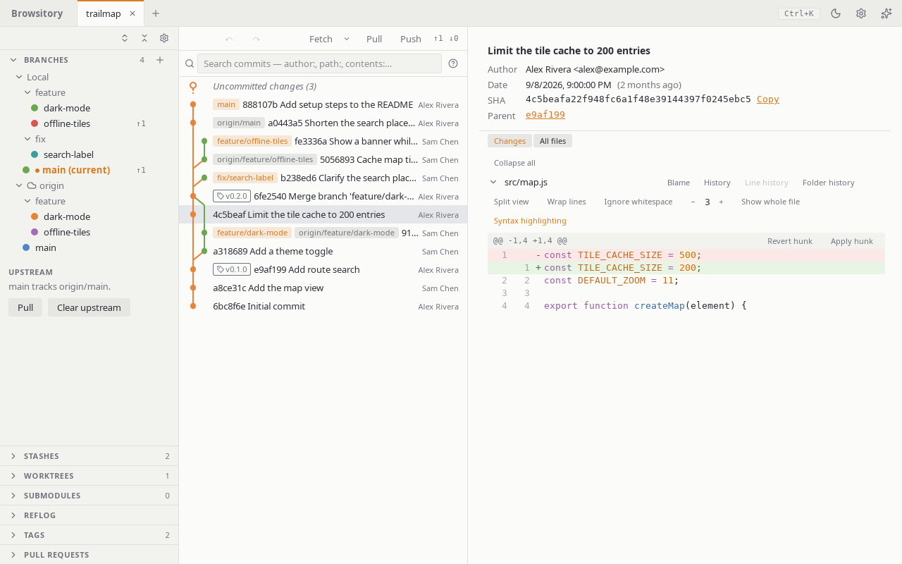

# Branches and remotes

**Branches** is a single tree: a **Local** folder holding your local
branches, and one folder per remote holding that remote's branches (fetched
lazily the first time you expand it). Click a branch, local or remote, to select its latest
commit and scroll the graph there without checking anything out (as **Go to branch…** in the
command palette does). Double-click a local branch, or choose
**Checkout** from its context menu, to switch to it;
right-click a branch, a remote folder, or a remote branch to bring up its actions:

- a local branch: checkout, rename, delete, merge, **Push to…**, **Isolate branch** (the graph
  then shows only that branch's own commits and merges, see
  [Which branches the graph shows](history.md#which-branches-the-graph-shows)), and for the
  current branch **Set upstream…** and **Push to ⟨remote⟩**;
- a remote branch: checkout, **Set as upstream for current branch**, **Isolate branch** (as for
  a local branch), or **Delete ⟨remote⟩/⟨branch⟩…**;
- a remote: fetch, **Push current branch here**, edit, manage credentials, or remove.

The **+** button in the section header opens **New branch…**, **Add remote…** and **Show all
branches**. Creating a branch from a specific commit, or starting a rebase onto one, is
available from that commit's row in the graph.

**Upstream.** The bottom of the section says which remote branch the current branch tracks
("main tracks origin/main."). **Pull** pulls from it. **Clear upstream** removes the setting
(after asking); the branches themselves don't change. To set an upstream, use **Set upstream…**
in the current branch's menu, or **Set as upstream for current branch** on a remote branch.
While a merge, rebase, cherry-pick or revert is in progress, or another action, a fetch, pull or
push runs, deleting a branch and setting or clearing the upstream are disabled, and their
confirmations say why.

**From the keyboard.** Tab to a branch, a remote branch or a remote folder and press the Menu key
or Shift+F10 (Fn+Shift+F10 on most Mac keyboards), or use its **…** button, to open the same menu.
In any menu, ↑/↓, Home/End or a letter move between items, Enter or Space runs one, Esc closes
the menu and returns to the row, and Tab closes it and moves on. The command palette also has
**Edit remote …**, **Manage credentials for …** and **Remove remote …** for each remote; they
open the same dialogs (Remove still asks first), even while the Branches section is collapsed.

**Publishing a branch.** **Push to…** pushes any local branch to a remote under any name.
The dialog asks for the remote (the branch's upstream remote, else `origin`), the remote
branch name (the local name by default) and **Set as upstream**, which is on by default for
a branch that has no upstream yet. The sync bar's **Push** opens the same dialog when the
current branch has no upstream, so a new branch is published in one step.

**Where Push goes** follows your git `push.default` (unset means `simple`). With `simple`, a
branch whose upstream has a different name — say `feat`, created from `origin/main` and so
tracking it — is not pushed onto `main`: **Push** opens **Push to…** with that remote and the
branch's own name instead. Set `push.default=upstream` to push to the upstream branch, or
`current` to push to the same name. With `nothing`, Push always asks. Force push follows the same
rule.

**Ahead/behind.** A local branch with an upstream shows `↑n` (commits to push) and `↓m`
(commits to pull) next to its name, counted against the last fetch. Nothing is shown when the
branch is in sync, or when its upstream has never been fetched.

**Fetching every remote.** The chevron next to **Fetch** opens **Fetch all remotes** and a
**Prune** toggle. Pruning removes remote-tracking branches whose branch was deleted on the
remote. The toggle is remembered per repository; until you set it, your git config
(`remote.<name>.prune`, then `fetch.prune`) decides per remote. If a remote fails during Fetch
all (unreachable, missing credentials), the others are still fetched and the error names the
ones that failed.

## Fetching automatically

Ahead/behind counts and remote branches are only as fresh as the last fetch. To keep them
current, open **Preferences → Fetch** and choose how often **Fetch automatically** fetches: off
(the default), every 5, 10 or 30 minutes, or every hour. The setting applies to every
repository; **In <repository>** below it overrides it for the open repository alone (for
example, off for a slow server, or more often for a busy project). Choose **Use the app
setting** to follow the app-wide choice again.

A background fetch fetches all remotes, quietly: no progress panel, no "Fetch complete" toast,
nothing to undo, and the window keeps its focus. It uses the repository's **Prune** choice like
**Fetch all remotes**, and the history, branches and ahead/behind counts refresh when it is done.

- It runs only for the open tab, and waits while the window is minimized (in VSCode: while the
  Browsitory panel is behind another tab). Coming back after the interval passed fetches at once.
- It never runs alongside something else: while another action runs (a commit, a push, a manual
  fetch, …) it waits, and an action you start stops a background fetch that is still running.
- It never asks for a password or a token. A remote that would need one (no saved HTTPS token,
  a locked credential store, no key in the SSH agent) is skipped, and a short notice names it
  once per session; **Credentials…** in the notice opens that remote's credentials. Other
  failures stay quiet; the next fetch tries again.
- It never keeps you waiting for a server that doesn't answer (VPN down, captive portal, server
  offline). An action you start goes ahead at once, even while the background fetch is still
  trying to connect, and a remote that hasn't answered within 30 seconds is given up on for that
  fetch; the other remotes are still fetched. A remote that couldn't be reached is then fetched
  less often, quietly: after twice the interval, then four times, up to once an hour. Fetching it
  yourself, or a background fetch that gets through, brings back the normal interval.
- It never makes your system ask to unlock its credential store (keychain, keyring) either.
  A saved HTTPS token is used in the background only after Browsitory has already read or
  saved a token in this session: a fetch, pull or push you started, or saving a token in a
  remote's **Credentials** dialog. Until then an HTTPS remote that uses a saved token is skipped
  as above; fetch once yourself to let the background fetch use it.

The sync bar shows when the repository was last fetched in this session, by you or in the
background ("Fetched 3 minutes ago"); hover over it for the time and the interval.

**Merge options.** **Merge into current branch…** opens a dialog naming both branches. Choose
**Fast-forward if possible** (move the branch when nothing diverged, else create a merge
commit), **Always create a merge commit** (even when a fast-forward was possible; the commit box
is pre-filled and the commit gets two parents), or **Fast-forward only** (refuse, changing
nothing, when the branches have diverged). **Squash** stages the combined changes of the branch
without committing and without recording a merge: HEAD does not move, the commit box is
pre-filled with the squashed commits' messages, and the commit you make has a single parent.
**Undo** reverts a squash. The dialog remembers your last choice per repository; until then it
follows your git `merge.ff` (`false` = always a merge commit, `only` = fast-forward only). The
**Merge** button of the "Pull has diverged" prompt always allows a fast-forward and does not ask.

**Deleting a remote branch** deletes it on the remote and removes its remote-tracking branch.
Like every network operation, it can't be undone with **Undo**. Local branches that tracked it
keep their upstream setting (git shows such an upstream as "gone").

