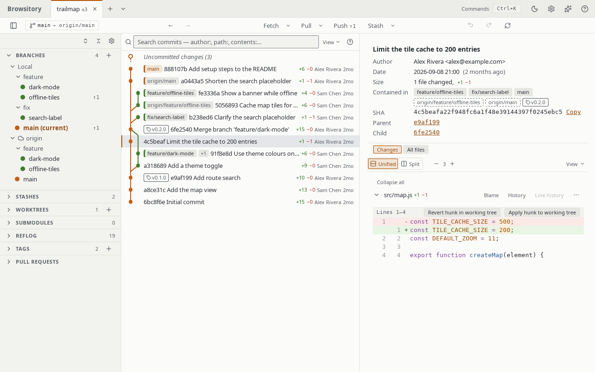

# Branches and remotes

**Branches** is a single tree: a **Local** folder holding your local branches, and one folder
per remote holding that remote's branches (fetched lazily the first time you expand it). The
branch you are on reads in bold, with "(current)" after its name.

- **Switch to a branch:** double-click a local branch, or choose **Switch to** from its context
  menu.
- **Look at a branch without switching:** click it, local or remote, to select its latest commit
  and scroll the graph there (as **Go to branch…** in the command palette does).
- **Everything else:** right-click a branch, a remote folder or a remote branch to bring up its
  actions.

The menus offer:

- a local branch: **Switch to**, **Rename…** (a dialog asks for the new name and says there why
  a name can't be used), delete, merge, **Rebase current branch onto ⟨branch⟩…** (see
  [Rebase](rebase.md)), **Push to…**, **Isolate branch** (the graph then shows only that branch's
  own commits and merges, see
  [Which branches the graph shows](history.md#which-branches-the-graph-shows)), **Show all
  branches** (while the graph leaves some branch out), and for the current branch **Set upstream…**, **Clear upstream…** and **Push to ⟨remote⟩**, and **Copy
  branch name**. Delete goes at once when every commit of the branch is on another branch
  (local or remote-tracking) or a tag too; otherwise it asks first, saying how many commits would
  be on no branch ("feature has 1 commit on no other branch. Delete it anyway?", **Delete
  branch**). While it counts those commits, that branch's **Delete** is unavailable. The
  current branch's **Delete** is unavailable too and says "Switch to another branch first."
  **Undo** brings it back;
- a remote branch: **Switch to** (to a local branch tracking it), **Set as upstream for current
  branch**, **Rebase current branch onto ⟨remote⟩/⟨branch⟩…**, **Isolate branch** (as for a
  local branch), **Show all branches** (as for a local branch), **Copy branch name** (as
  `remote/branch`), or **Delete
  ⟨remote⟩/⟨branch⟩…**;
- a remote: **Fetch**, **Push current branch to ⟨remote⟩**, **Edit remote…**, **Manage
  credentials…**, **Copy fetch URL** (and **Copy push URL** when pushes go to a different URL),
  or **Remove remote…**.

On a detached HEAD there is no current branch: **Set as upstream for current branch** and
**Push current branch to ⟨remote⟩** are unavailable and say "Check out a branch first."

??? note "Details"
    The copy items put plain text on the clipboard and work even while another operation runs;
    a short notification confirms the copy, or an error says why it failed.

    While a merge, rebase, cherry-pick or revert is in progress, or another action, a fetch,
    pull or push runs, the branch and remote actions that change something (switching, rename,
    merge, push, delete, setting or clearing the upstream, and a remote's fetch, edit,
    credentials and remove) are disabled with the reason, and the command palette leaves out
    their commands; an open confirmation or remote dialog says why and doesn't save. **New
    branch…** and **Add remote…** still open their forms, whose **Create** and **Add remote**
    buttons wait.

    **From the keyboard.** Tab to a branch, a remote branch or a remote folder and press the
    Menu key or Shift+F10 (Fn+Shift+F10 on most Mac keyboards), or use its **…** button, to open
    the same menu. In any menu, ↑/↓, Home/End or a letter move between items, Enter or Space
    runs one, Esc closes the menu and returns to the row, and Tab closes it and moves on. The
    command palette also has **Edit remote ⟨name⟩…**, **Manage credentials for ⟨name⟩…** and
    **Remove remote ⟨name⟩…** for each remote; they open the same dialogs (Remove still asks
    first), even while the Branches section is collapsed.

    **A user name or token in a remote's URL.** Browsitory refuses an `https://` or `http://`
    URL with a user name, token or password in it, but a repository cloned with Git or another
    program can have one (Bitbucket copies its URLs as `https://alice@bitbucket.org/…`). Such a
    remote is listed with `***` in place of the user name and password, everywhere: the remote's
    menu, **Copy fetch URL**, **Edit remote…**. Fetch, pull and push use the URL as saved, as
    Git does. In **Edit remote…**, a note under the URL says it is hidden: leave the URL as it
    is (or only rename the remote) to keep the saved URL. To remove the user name, enter the URL
    without it, save, and set the user name and token in **Manage credentials…**. A URL with
    `***` that isn't the saved one is refused, like any other URL with a user name.

## Creating a branch

The **+** button in the section header opens **New branch…**, **Add remote…** and **Show all
branches**. The New branch form's **Switch to it after creating** is on at first, as `git switch
-c`, and keeps your last choice; creating and checking out is one step, which one **Undo** takes
back. **Create branch…** in the command palette, or in the toolbar's branch list, opens the same
form, also in a narrow window. Escape closes the New branch and Add remote forms from anywhere
inside them, and the focus goes back to where it was. Creating a branch from a specific commit,
or starting a rebase onto one, is available from that commit's row in the graph.

## Switching with local changes

When your changes to a file (or an untracked file) would be overwritten by switching branches,
the switch doesn't happen, and a dialog names the files in the way. **Stash and switch** stashes
all your local changes, untracked files included, switches, and with **Re-apply the changes on
⟨branch⟩** (on by default) applies them there and drops the stash.

??? note "Details"
    Changes that conflict on the new branch are left to resolve, and stay in the stash list too;
    without re-applying they wait in the stash list. **Undo** goes back to the branch you were
    on with the changes in your working tree; a stash entry the switch left stays in the list
    (the undo history doesn't cover stashes), and a re-apply with conflicts isn't on the undo
    history.

## Merging

**Merge into current branch…** opens a dialog naming both branches. Under **How to merge**,
choose **Fast-forward if possible** (move the branch when nothing diverged, else create a merge commit), **Always create
a merge commit** (even when a fast-forward was possible; the commit box is pre-filled and the
commit gets two parents), or **Fast-forward only** (refuse, changing nothing, when the branches
have diverged; the error then suggests merging without it or rebasing first). **Squash** stages the combined changes of the branch without committing and
without recording a merge: HEAD does not move, the commit box is pre-filled with the squashed
commits' messages, and the commit you make has a single parent; the choices above it don't apply
then. **Undo** reverts a squash.

??? note "Details"
    The dialog remembers your last choice per repository; until then it follows your git
    `merge.ff` (`false` = always a merge commit, `only` = fast-forward only). A pull that merges
    (see [Pulling](#pulling)) always allows a fast-forward and does not ask.

??? note "Details: sparse checkouts"
    In a sparse checkout (`git sparse-checkout`), switching branches, checking out a commit,
    merging, pulling, cherry-picking, reverting and rebasing leave the files outside the chosen
    folders out, as git does: a file there that the other branch or commit changes gets its new
    version in the index without being written to disk, a file it adds there isn't written
    either, and neither is listed as a change. A conflict in such a file is written to disk with
    its conflict markers, so you can resolve it, and stays there like any file of the chosen
    folders. git's merge does the same; its cherry-pick, revert and rebase leave that file off
    the disk. **Abort** puts the earlier versions back the same way, without writing them. A file outside the folders that is on disk anyway and that the operation changes
    is taken off the disk again, as git does; other files keep their state (git would take off
    every unchanged file outside the folders too; `git sparse-checkout reapply` does that).
    With patterns set by `git sparse-checkout set --no-cone`, which Browsitory doesn't match,
    a file the operation adds counts as outside when it isn't on disk.

**Dragging a branch onto a branch.** Drag a branch onto the current branch, or the current
branch onto another branch, to merge or rebase. On release a small menu lets you choose, with
the more likely choice first: a branch dropped on the current branch offers **Merge ⟨branch⟩
into ⟨current⟩…**, then **Rebase ⟨current⟩ onto ⟨branch⟩…**; the current branch dropped on a
branch offers the rebase first. Both open the same dialog or planner as the menu items, so
nothing runs until you confirm there. The menus and the command palette offer the same actions
without dragging.

??? note "Details"
    While you drag, a label beside the pointer says what the drop offers, and the branch under
    the pointer is highlighted. A remote branch offers only the rebase. Only the current branch
    can be merged into or rebased, so dropping one other branch onto another, or any drop on a
    detached HEAD or while another operation runs, is refused, and the label says why. A
    collapsed folder opens when you hold a branch over it for a moment (only for now; it doesn't
    stay open next time). Escape cancels the drag.

## Pushing and upstreams

**Push** in the repository toolbar pushes the current branch to its upstream, and **Pull** pulls
from it (see [The main window](main-window.md) and [Pulling](#pulling)). Point at the current
branch to see which remote branch it tracks ("Tracks origin/main"). **Clear upstream…** in its
menu removes the setting (after asking); the branches themselves don't change. To set an upstream, use **Set upstream…** in the current branch's menu
(it opens with the only remote, or `origin`, and the branch's own name filled in), or **Set as
upstream for current branch** on a remote branch.

**Publishing a branch.** **Push to…** pushes any local branch to a remote under any name. The
dialog asks for the remote (the branch's upstream remote, else `origin`), the remote branch name
(the local name by default) and **Set as upstream**, which is on by default for a branch that
has no upstream yet. The toolbar's **Push** opens the same dialog when the current branch has no
upstream, so a new branch is published in one step.

**Ahead/behind.** A local branch with an upstream shows `↑n` (commits to push) and `↓m` (commits
to pull) next to its name, counted against the last fetch. Nothing is shown when the branch is
in sync, or when its upstream has never been fetched.

??? note "Details"
    **Where Push goes** follows your git `push.default` (unset means `simple`). With `simple`, a
    branch whose upstream has a different name — say `feat`, created from `origin/main` and so
    tracking it — is not pushed onto `main`: **Push** opens **Push to…** with that remote and
    the branch's own name instead. Set `push.default=upstream` to push to the upstream branch,
    or `current` to push to the same name. With `nothing`, Push always asks. Force push follows
    the same rule.

## Fetching

**Fetch** is in the repository toolbar. The chevron next to it opens **Fetch all remotes** and a
**Prune** toggle. Pruning removes remote-tracking branches whose
branch was deleted on the remote.

While a fetch, pull or push runs, the repository toolbar names it ("Pushing main to
origin/main"), with a progress bar, the objects and bytes sent or received, and **Cancel**. When
it is done, a notification says what happened: "Pushed 2 commits to origin/main", "Fetched from
origin. main is 3 commits behind origin/main." (with **Pull**), "main is 2 commits ahead of
origin/main." (with **Push**), "main and origin/main have diverged: 1 commit ahead, 1 behind."
(with **Pull**, which asks whether to merge or rebase), or "Nothing to push" when the remote
already had everything. A fetch, pull or push that fails names what it worked on and the next
step, such as "Couldn't fetch from origin. Check the remote's URL and your connection, then try
again."; **Details** shows the cause in the operation log.

??? note "Details"
    The **Prune** toggle is remembered per repository; until you set it, your git config
    (`remote.<name>.prune`, then `fetch.prune`) decides per remote. If a remote fails during
    Fetch all (unreachable, missing credentials), the others are still fetched and the error
    names the ones that failed.

    While a transfer runs, the window stays usable: you can scroll the history, open the
    sidebar, and open a commit, a diff, blame, file history or a search, which show at once.
    Only while a pull merges and runs its `post-merge` hook do these reads wait until it ends.
    Actions that change the repository wait for the transfer, and their buttons say why.

    **Cancelling a fetch, pull or push.** Click **Cancel** next to its progress. While it is
    still connecting (a server that doesn't answer, a VPN that is down), Cancel stops it at once
    and you can go on working: nothing has been fetched or sent, and the repository is
    unchanged. Once data is flowing, a fetch stops at its next progress step; a pull cancelled
    during its fetch doesn't merge. A fetch or pull that stopped receiving (the Wi-Fi changed,
    the VPN dropped, the laptop slept) stops within about two seconds of Cancel, without
    updating any remote branch. A push can be cancelled until it starts sending; after that
    it finishes and reports how it went, because the remote may already have taken it.

    A fetch, pull, push or clone that receives nothing for two minutes fails on its own, even
    without Cancel. On Windows this doesn't apply to HTTPS remotes: there, Cancel stops a
    stalled fetch or pull, and a stalled push waits until Windows gives up on the connection.

## Fetching automatically

Ahead/behind counts and remote branches are only as fresh as the last fetch. To keep them
current, open **Preferences → Fetch** and choose how often **Fetch automatically** fetches: off
(the default), every 5, 10 or 30 minutes, or every hour. The setting applies to every
repository; **For this repository (<name>)** below it overrides it for the open repository alone (for
example, off for a slow server, or more often for a busy project). Choose **Use the app
setting** to follow the app-wide choice again.

A background fetch fetches all remotes, quietly: no progress in the toolbar, no notification,
nothing to undo, and the window keeps its focus. The toolbar shows when the repository was last
fetched in this session, by you or in the background ("Fetched 3 minutes ago"); hover over it
for the time and the interval.

??? note "Details"
    A background fetch uses the repository's **Prune** choice like **Fetch all remotes**, and
    the history, branches and ahead/behind counts refresh when it is done.

    - It runs only for the open tab, and waits while the window is minimized (in VSCode: while
      the Browsitory panel is behind another tab). Coming back after the interval passed fetches
      at once.
    - It never runs alongside something else: while another action runs (a commit, a push, a
      manual fetch, …) it waits, and an action you start stops a background fetch that is still
      running.
    - It never asks for a password or a token. A remote that would need one (no saved HTTPS
      token, a locked credential store, no key in the SSH agent) is skipped, and a short notice
      names it once per session; **Credentials…** in the notice opens that remote's
      credentials. Other failures stay quiet; the next fetch tries again.
    - It never keeps you waiting for a server that doesn't answer (VPN down, captive portal,
      server offline). An action you start goes ahead at once, even while the background fetch
      is still trying to connect, and a remote that hasn't answered within 30 seconds is given
      up on for that fetch; the other remotes are still fetched. A remote that couldn't be
      reached is then fetched less often, quietly: after twice the interval, then four times, up
      to once an hour. Fetching it yourself, or a background fetch that gets through, brings
      back the normal interval.
    - It never makes your system ask to unlock its credential store (keychain, keyring) either.
      A saved HTTPS token is used in the background only after Browsitory has already read or
      saved a token in this session: a fetch, pull or push you started, or saving a token in a
      remote's **Credentials** dialog. Until then an HTTPS remote that uses a saved token is
      skipped as above; fetch once yourself to let the background fetch use it.

## Pulling

**Pull** fetches the upstream's remote and fast-forwards the current branch when it has no
commits of its own. When both the branch and its upstream have new commits, the pull combines
them the way your pull strategy says:

- **Pull with merge**: merges the upstream into the branch (a merge commit, or conflicts to
  resolve);
- **Pull with rebase**: replays the branch's own commits onto the upstream, a plain rebase that
  pauses on a conflict like any other (see [Rebase](rebase.md)); the interactive planner doesn't
  open. Commits that already reached the upstream another way (cherry-picked, rebased or
  squash-merged by a pull request) are left out, as `git pull --rebase` leaves them out;
- **Pull, fast-forward only**: stops and asks, changing nothing.

Choose one from the menu next to **Pull** (or in the command palette): it is remembered for this
repository and pulls at once. Until you choose, a diverged pull asks in a dialog that names both
branches and counts the commits each has: **Pull with merge**, **Pull with rebase** or
**Cancel**, with **Always do this for ⟨repository⟩**, which you can change later in the Pull
menu. A merge, or a rebase that finished, can be undone with **Undo**.

Your local changes don't stop a pull unless it would overwrite them, as with `git pull`: a
fast-forward keeps your edits, staged changes and untracked files in the files it doesn't
change. When a file the pull changes has edits of yours, or an untracked file stands where it
writes one, it stops after fetching, names the files ("the pull would overwrite your local
changes to notes.txt") and changes nothing: commit or stash them, then pull again. A pull that
merges or rebases leaves that check to the merge or the rebase (which, like `git rebase`, doesn't
start while tracked files have changes). **Undo** of a pull keeps your local changes.

??? note "Details"
    Until you choose a strategy, Browsitory follows your git config like `git pull`:
    `branch.<name>.rebase`, else `pull.rebase` (`true`, `merges` or `interactive` rebase,
    `false` merges), else `pull.ff=only`. Only with none of them set does a diverged pull ask.

    If your git config asks for a merge commit instead of a fast-forward, like `git pull` reads
    it (`pull.ff=false`, else `--no-ff` in `branch.<name>.mergeoptions`, else
    `merge.ff=false`), the pull merges the upstream with a merge commit: the commit box is
    filled with the merge message, and you commit it as any merge (the commit gets two parents;
    **Undo** takes the merge back). A rebase set in git config, or **Pull with rebase** or
    **Pull, fast-forward only** chosen in the app, fast-forwards instead, as `git pull` does
    with `pull.rebase`.

## Deleting a remote branch

**Delete ⟨remote⟩/⟨branch⟩…** deletes the branch on the remote and removes its remote-tracking
branch. Like every network operation, it can't be undone with **Undo**. Local branches that
tracked it keep their upstream setting (git shows such an upstream as "gone").
