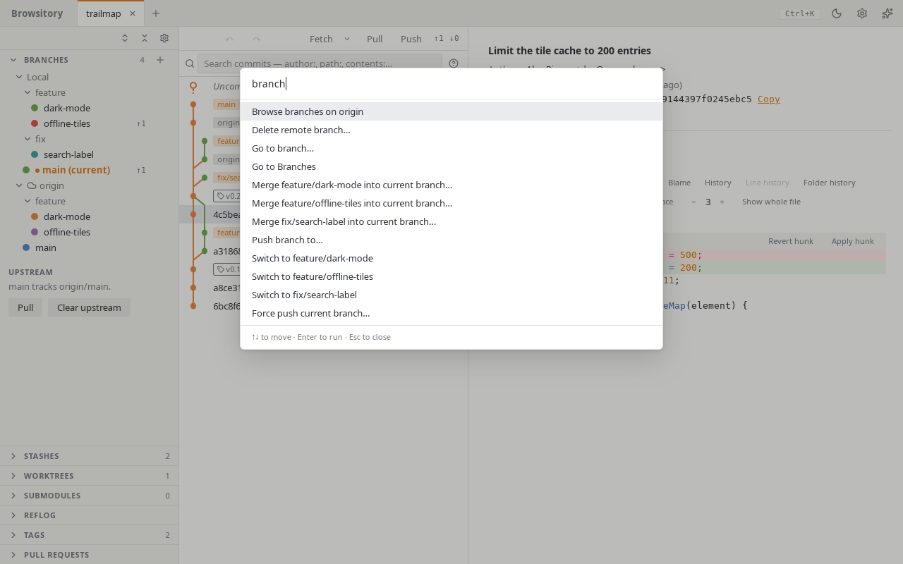

# Command palette and shortcuts

## Command palette

Press **Ctrl+K** (**⌘K** on macOS) anywhere to open the command palette, or click
**Commands** in the header. Before you type, it lists every command it can run now: the ones you
used last under **Recent**, then the rest in their groups. Type to filter the list. The words you
type can come in any order and can be shortened: `sw main` finds **Switch to main**, and `ftch`
finds **Fetch origin**. The best match comes first, and the letters that matched are marked.

Use ↑/↓ to pick a command and Enter to run it, or click one. PageUp/PageDown move a page at a
time, and Ctrl+Home/Ctrl+End (or Home/End before you type) go to the first or last command.
Pointing at a command with the mouse picks it too.

The palette has almost every action in Browsitory, grouped like this:

- **Branches:** switch to a branch, **Switch branch…** (the list the toolbar's branch button
  opens, see [The main window](main-window.md)), **Create branch…** (the New branch form),
  merge a branch into the current one, and create, check out or delete a tag.
- **Remotes:** fetch one or all remotes, pull, **Pull with merge**, **Pull with rebase** and
  **Pull, fast-forward only** (each also remembered for the repository), push, **Push branch to…**, **Force push current
  branch…**, push all tags, **Browse branches on ⟨remote⟩**, add, edit or remove a remote,
  manage its credentials, delete a remote branch, and delete a tag on a remote.
- **Stash:** stash all, **Stash…**, stash the current file or the selected files, and show,
  apply, pop or drop a stash.
- **Diff:** ignore whitespace, show whitespace, more or fewer context lines, syntax
  highlighting, wrap lines and show whole file in the current diff (see [Diff options](history.md#diff-options)), file
  history of the current file, stage, unstage or discard the selected files, discard the current
  file or all unstaged changes, open the current file in your editor or diff tool, **Apply
  patch…** and **Save staged changes as patch…** (see [Patches and partial
  reverts](patches.md)).
- **Go to:** **Go to commit…**, **Go to branch…**, **Go to tag…** and **Go to stash…** (see
  below), open a sidebar section and move to it, for example **Go to Tags**, and **Show
  sidebar** or **Hide sidebar**.
- **Repositories:** switch to another tab (one command per tab, or **Switch to tab…** to pick
  one by name, folder name or path), **Rename tab…**, close the tab, open a terminal, reveal the
  repository in the file manager (see [Multiple repositories](tabs.md)).
- **General:** **Refresh**, undo and redo, search commits, the selected commit's actions
  (cherry-pick, revert, reset, check out, reword, squash, fixup, move, drop; for a search
  result or file history commit older than the loaded history, all but the history edits),
  worktree and submodule actions, **Preferences…**, **Show keyboard shortcuts**, **Check for
  updates** (desktop app), **Third-party licences** and **Open user guide**.

Before you type, commands that can't run right now are left out. For example, while a rebase is
paused, the list offers only the commands that are safe until it is finished. Once you type, the
matching commands that can't run follow the others under **Unavailable now**, greyed out, each
with the reason, such as "A rebase is in progress." for **Push to origin**. Choosing one does
nothing.

## Go to a commit, branch, tag or stash

**Go to commit…**, **Go to branch…**, **Go to tag…** and **Go to stash…** select something and
scroll the graph to it without checking anything out: the working tree stays as it is. Choose
one, then type to filter its list and press Enter (Backspace in the empty field goes back to the
commands).

- **Go to commit…** lists the loaded commits; type the start of a SHA or words from the commit
  message. **Look up "…" in the whole repository** finds a SHA, branch, tag or any revision git
  understands (for example `v1.0~2`) also outside the loaded history, and **Search all history
  for "…"** opens the commit search with your text.
- **Go to branch…** lists the local branches and the remote branches the graph knows. You can
  also click a branch in the Branches section.
- **Go to tag…** lists every local tag. You can also click a tag in the Tags section.
- **Go to stash…** shows a stash, like clicking it in the Stashes section.

When the commit is further down than the loaded history, the graph loads more until it gets
there. When the graph doesn't show it at all, the commit is still selected (its changes show),
and a note above the graph says why: it is only on a branch the graph hides (**Show ⟨branch⟩**
adds that branch to the graph), it is on a side branch of the one branch the graph shows
(**Show all branches**), or it is on no branch at all. A commit inside a collapsed merge (see
[Collapse merges](history.md#collapse-merges)) is shown by expanding that merge.

## Keyboard shortcuts

Press **?** (outside a text field), or choose **Keyboard shortcuts** in the header's **Help**
menu, for the full list of shortcuts, written for your platform: **Ctrl** on Windows and Linux,
**⌘** and the other Apple symbols (⌥ Option, ⇧ Shift, ⌃ Control) on macOS. The command palette
shows a command's shortcut at the right of its row, and the toolbar's tooltips show theirs
(**Refresh (F5)**).

The global shortcuts work anywhere in the window:

| Windows and Linux | macOS | What they do |
|---|---|---|
| Ctrl+K | ⌘K | Open the command palette |
| F5 | F5 | Refresh the repository |
| Shift+F5 | ⇧F5 | Fetch, as the toolbar's **Fetch** does |
| Ctrl+Shift+L | ⇧⌘L | Pull the current branch |
| Ctrl+Shift+K | ⇧⌘K | Push the current branch, as the toolbar's **Push** does |
| Ctrl+Shift+A | ⇧⌘A | Stage all changes (outside a text field) |
| Alt+C | ⌥C | Show the working tree and go to the commit message (outside a text field) |
| Ctrl+Z | ⌘Z | Undo the last Git operation (outside a text field) |
| Ctrl+Shift+Z or Ctrl+Y | ⇧⌘Z | Redo |
| F6, Shift+F6 | F6, ⇧F6 | Move to the next or previous pane: toolbar, sidebar, history, diff |
| Ctrl+Alt+B | ⌥⌘B | Show or hide the sidebar |
| Ctrl+Tab, Ctrl+Shift+Tab | ⌃⇥, ⌃⇧⇥ | Switch to the next or previous tab |
| Ctrl+1 … Ctrl+8, Ctrl+9 | ⌘1 … ⌘8, ⌘9 | Switch to tab 1 to 8, or to the last tab |
| Ctrl+W | ⌘W | Close the active tab |
| Ctrl+Shift+T | ⇧⌘T | Reopen the last closed tab |
| Alt+← / Alt+→ | ⌘[ / ⌘] | Back and forward through the selected commits (outside a text field) |
| ? | ? | Show the keyboard shortcuts (outside a text field) |

A shortcut that can't run says why in a notification, for example "Can't pull now. No upstream
set for the current branch." The host may take some keys before Browsitory sees them: the
macOS app menu takes ⌘W, and in VSCode the editor's own keybindings may take Ctrl+Tab,
Ctrl+1 … Ctrl+9, Ctrl+W, Ctrl+Shift+T, Ctrl+Alt+B or Alt+←. The toolbar, the tab strip and the
command palette do the same things.

**Moving between panes.** F6 moves the focus to the next pane (the repository toolbar, the
sidebar, the history, the diff) and Shift+F6 to the previous one, wrapping around. A pane gets
the focus back where you left it; the first time, the history and the diff focus their list.
Screen readers announce the sidebar, history and diff as regions.

In lists and diffs (Ctrl means ⌘ on macOS):

| Keys | What they do |
|---|---|
| Ctrl+F | Search commits (with the commit list focused) |
| Ctrl+Enter | Commit (in the commit message) |
| ↑ / ↓ or j / k | Move through commits or changed files |
| Shift+↑ / Shift+↓ | Select several commits or changed files |
| Ctrl+A | Select every file in a change list (with the list focused) |
| Home / End, Page Up / Page Down | Jump in the commit list |
| s | Stage or unstage the selected files, lines or hunk |
| d d | Discard the selected lines or hunk |
| [ and ] | Previous and next hunk (in a diff); parent and child commit (in the commit list) |
| Shift+[ | Choose one of a merge commit's parents (in the commit list) |
| → / ← | Expand or collapse a merge with **Collapse merges** on (in the commit list) |
| ← / →, Home / End | Move between tabs, with a tab focused; Enter or Space switches |
| Delete | Close the focused tab |
| F2 | Rename the focused tab |
| Menu key or Shift+F10 | Open the focused item's menu |
| Esc | Close a dialog or menu |

**Context menus from the keyboard.** The Menu key or Shift+F10 (Fn+Shift+F10 on most Mac
keyboards) opens the menu of the focused branch, remote, changed file, commit or tab. In a menu,
↑/↓, Home/End or a letter move between items, Enter or Space runs one, Esc closes the menu, and
Tab closes it and moves on.

**Resizing.** With a divider between the columns focused, ← / → resize the columns.
Double-click a divider to collapse or expand the sidebar.
