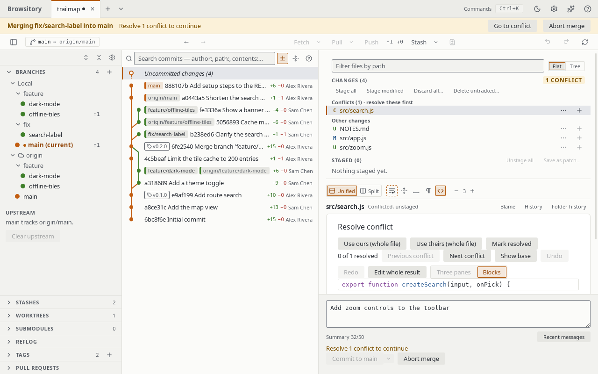

# Resolving conflicts

When a merge, cherry-pick, revert, rebase or stash pop conflicts, the conflicted files head the
**Changes** group, under **Conflicts** ("resolve these first"), with the other changes below
them. The group shows a badge such as **1 conflict**, and each file is marked "(Conflicted)".

The status strip at the top of the repository says what is in progress and where, for example **Merging
feature/x into main** or **Cherry-picking onto main**, with the number of conflicts left. **Go to
conflict** there shows the first conflicted file. During a rebase the strip also has **Continue
rebase** next to **Abort rebase**; it says "Resolve 1 conflict to continue" until no conflict is
left.

A conflicted file opens the **Resolve conflict** pane:

- For text conflicts, choose **Accept ours**, **Accept theirs** or **Accept both** for each
  conflicting block, then **Save resolution**. Every block starts unresolved: the pressed button
  shows your choice, **Result** under the block shows the text it gives, and a counter such as
  "1 of 3 resolved" shows how far you are. **Save resolution** is enabled once every block has a
  choice. The sides are labelled with what they are, for example "Ours (main)" and
  "Theirs (feature)" for a merge. **Previous conflict** and **Next conflict** move between the
  blocks.
- **Use ours (whole file)** keeps your current branch's version (HEAD) of the whole file and
  **Use theirs (whole file)** takes the incoming version: the commit being merged, cherry-picked
  or reverted, or the stash. During a rebase "ours" is the branch you are rebasing onto and
  "theirs" the commit being replayed. These work for every conflict, including binary files and
  files one side deleted (choosing the deleting side deletes the file). The file keeps the chosen
  side's executable bit. Symlink and submodule conflicts have to be resolved with git.
- **Mark resolved** stages the file as it is on disk, after you edited it yourself or in another
  tool. If it still contains `<<<<<<<` / `>>>>>>>` conflict markers, Browsitory asks before
  staging it. A deleted file is marked resolved as deleted.
- If the conflicted path is now a folder that holds a repository (a nested repository, a
  submodule's checkout or a linked worktree), **Mark resolved** stages the commit that
  repository has checked out, as `git add` does. Browsitory only reads that repository's git
  folder when it is inside the work tree, for example a submodule's under `.git/modules`, and
  written with the same path as the work tree. When it can't stage the folder, it says why: the
  folder isn't a repository, the repository has no commit yet, its git folder (or a linked
  worktree's main repository) is outside the work tree, at a path Browsitory can't match to the
  work tree, or can't be found, or the repository uses a format Browsitory can't read (SHA-256,
  reftable). Stage such a folder with `git add <path>` in a terminal.

When one side has a file and the other a folder of the same name (`c` and `c/g`), git can't
keep both under that name. Like git, a merge, cherry-pick, revert, rebase step or stash apply
then writes the folder's files and moves the file aside as a conflict: `c~HEAD` when the file
is yours (`c~Updated upstream` for a stash apply), or `c~<branch>` (`c~<commit> (<subject>)`
for a cherry-pick or rebase step, `c~parent of <commit> (<subject>)` for a revert,
`c~Stashed changes` for a stash) when it comes in. Keep the moved file under a name of your
choice, or delete it, then mark it resolved. A stash apply with
**Restore staged changes** refuses instead and changes nothing, as `git stash apply --index`
does; apply it without that option.

If the conflicted file is read-only, **Save resolution**, **Use ours (whole file)** and **Use
theirs (whole file)** change nothing and say so: "'f.txt' is read-only. Make it writable, then
try again." Clear the file's read-only flag (Windows) or give yourself write permission (macOS,
Linux), then try again. Choosing the side that deleted the file still deletes it.

**Save resolution** writes a complete new copy of the file next to it and then swaps it in. If
the write fails partway (for example on a full disk), the file stays as it was. On Windows, if
another program keeps the file open so it can't be swapped, Browsitory says "'f.txt' is open
in another program. Close it, then try again." and changes nothing. Because the file is
replaced, you need permission to create files in its folder. If the file is a hard link, its
other names keep the old content. If Browsitory stops in the middle of a write (a crash or a
power cut), a file named like `.f.txt.browsitory-1234-0.tmp` can be left next to the file
(hidden on macOS and Linux, visible on Windows); you can delete it.
