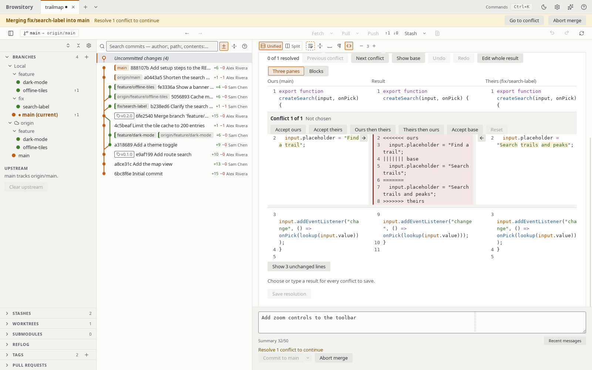

# Resolving conflicts

When a merge, cherry-pick, revert, rebase or stash pop conflicts, the conflicted files head the
**Changes** group, under **Conflicts** ("resolve these first"), with the other changes below
them. The group shows a badge such as **1 conflict**, and each file is marked "(Conflicted)".

The status strip at the top of the repository says what is in progress and where, for example **Merging
feature/x into main** or **Cherry-picking onto main**, with the number of conflicts left. **Go to
conflict** there shows the first conflicted file. During a rebase the strip also has **Continue**
next to **Abort rebase**; it says "Resolve 1 conflict to continue" until no conflict is
left.

A conflicted file opens the **Resolve conflict** pane:

- For text conflicts the pane is a merge editor. It shows the file with each conflicting block
  in place; long runs of unchanged lines are collapsed to the three lines next to a conflict
  (**Show N unchanged lines** shows the rest). It has two layouts, and remembers the one you
  pick. **Three panes**, the default, shows the whole file three times side by side: our
  version on the left, the result in the middle and their version on the right, each with its
  own line numbers. The unchanged lines stay level across the panes and the panes scroll
  together; each conflicting block sits between them with its choices, our lines, the editable
  result and their lines. The arrow next to a block's lines in the ours pane (**Take ours**) or
  the theirs pane (**Take theirs**) puts those lines into the result; taking the other side
  then adds its lines after them, the same as **Ours then theirs** or **Theirs then ours**.
  Over the base or a result you typed, an arrow replaces it with that side. An arrow is
  disabled while its side is in the result; **Reset** undoes it.

  In the three panes the whole result is editable, the unchanged lines too (a collapsed run
  once you show it): click into the middle pane and type. A block without a choice shows git's
  conflict markers there (`<<<<<<< ours`, `||||||| base`, `=======`, `>>>>>>> theirs`); delete
  the markers and keep the lines you want, or take a side. Each result line is marked with
  where it came from: our lines, their lines, the base, typed lines, or a conflict still to
  resolve. Typing into a resolved block marks it "Edited". **Undo** and **Redo**, or **Ctrl+Z**
  and **Ctrl+Shift+Z** / **Ctrl+Y** (⌘Z and ⇧⌘Z on macOS) with the focus in the merge editor,
  step back and forth through your changes: typing, arrows, choices and **Reset**. Keystrokes in
  one place without a pause are one step. Inside the merge editor these keys undo the merge
  editor's changes, not the last Git operation.

  **Blocks** shows each conflicting block on its own, our lines and
  their lines side by side above its result. When the pane is too narrow for three panes (the
  VS Code side panel, for example), the merge editor shows the blocks. **Show base** adds the
  common ancestor's lines ("Empty: no common lines" when there are none, for example when both
  sides added the file): in the three panes as a fourth pane, **Base**, on the left, level with
  the others and numbering the base's own lines; in the blocks above each block's sides. For each block choose **Accept ours**,
  **Accept theirs**, **Ours then theirs**, **Theirs then ours** or **Accept base**, or type the
  block's **Result** yourself: the result field is editable, and typing in it marks the block
  "Edited". **Reset** clears a block's choice and edits. Every block starts unresolved: the
  pressed button and the label next to the block's title show your choice, and a counter such
  as "1 of 3 resolved" shows how far you are (a block counts once it has a result without a
  conflict marker). **Save resolution** is enabled once every block has a result and no
  `<<<<<<<` or `>>>>>>>` line is left anywhere in the file. The sides are labelled with what they are, for example "Ours (main)" and
  "Theirs (feature)" for a merge. **Previous conflict** and **Next conflict** move between the
  blocks; from an unchanged part of the result you were typing in, they go to the conflict
  before or after it. Our lines, their lines, the base and the unchanged lines are syntax highlighted like
  the diff, following the diff's **Syntax highlighting** option; in the result, the lines you
  took from a side or left unchanged are highlighted too, and typed lines stay plain. Inside a
  block, the words that differ between our line and their line are marked, as in the diff. A
  line both sides have, a line only one side has, and a pair of lines with no word in common
  are not marked.

  

- From the keyboard: with a block focused, **1** to **5** take **Accept ours**, **Accept
  theirs**, **Ours then theirs**, **Theirs then ours** and **Accept base**. **F7** and
  **Shift+F7** (⇧F7 on macOS) go to the next and previous conflict from anywhere in the merge
  editor and focus that block. In a block's **Result** field the digits are typed as text: press
  **Esc**, **Shift+Tab** or **F7** first to get back to a block. The command palette offers the
  same moves and choices (**Next conflict**, **Accept theirs (current conflict)** and so on) for
  the conflict last focused (the first one before that).
- **Edit whole result** turns the file into one text field, for changes outside the blocks too.
  It starts from your choices; a block without one is written with git's conflict markers
  (`<<<<<<< ours`, `||||||| base`, `=======`, `>>>>>>> theirs`), and **Save resolution** stays
  disabled until no `<<<<<<<` or `>>>>>>>` line is left. **Back to blocks** returns to the
  blocks with their choices; if you changed the text, Browsitory asks first, because those
  changes are dropped.
- **Use ours (whole file)** keeps your current branch's version (HEAD) of the whole file and
  **Use theirs (whole file)** takes the incoming version: the commit being merged, cherry-picked
  or reverted, or the stash. During a rebase "ours" is the branch you are rebasing onto and
  "theirs" the commit being replayed. These work for every conflict, including binary files and
  files one side deleted (choosing the deleting side deletes the file). The file keeps the chosen
  side's executable bit. Symlink and submodule conflicts have to be resolved with git.
  A binary file has no lines to merge: the pane says so and offers only these.
- **Mark resolved** stages the file as it is on disk, after you edited it yourself or in another
  tool. If it still contains `<<<<<<<` / `>>>>>>>` conflict markers, Browsitory asks before
  staging it. A deleted file is marked resolved as deleted.
- If the conflicted path is now a folder that holds a repository (a nested repository, a
  submodule's checkout or a linked worktree), **Mark resolved** stages the commit that
  repository has checked out, as `git add` does. Browsitory only reads that repository's git
  folder when it is inside the work tree, for example a submodule's under `.git/modules`, and
  written with the same path as the work tree. When it can't stage the folder, it says why: the
  folder isn't a repository, the repository has no commit yet, its git folder (or a linked
  worktree's main repository) is outside the work tree, at a path Browsitory can't match to the
  work tree, or can't be found, or the repository uses a format Browsitory can't read (SHA-256,
  reftable). Stage such a folder with `git add <path>` in a terminal.

When one side has a file and the other a folder of the same name (`c` and `c/g`), git can't
keep both under that name. Like git, a merge, cherry-pick, revert, rebase step or stash apply
then writes the folder's files and moves the file aside as a conflict: `c~HEAD` when the file
is yours (`c~Updated upstream` for a stash apply), or `c~<branch>` (`c~<commit> (<subject>)`
for a cherry-pick or rebase step, `c~parent of <commit> (<subject>)` for a revert,
`c~Stashed changes` for a stash) when it comes in. Keep the moved file under a name of your
choice, or delete it, then mark it resolved. If the stash's staged changes meet such a file
and folder, **Apply** and **Pop** (which restore them as staged) refuse instead and change
nothing, as `git stash apply --index` does; use **Apply as unstaged** or **Pop as unstaged**.

If the conflicted file is read-only, **Save resolution**, **Use ours (whole file)** and **Use
theirs (whole file)** change nothing and say so: "'f.txt' is read-only. Make it writable, then
try again." Clear the file's read-only flag (Windows) or give yourself write permission (macOS,
Linux), then try again. Choosing the side that deleted the file still deletes it.

**Save resolution** writes a complete new copy of the file next to it and then swaps it in. If
the write fails partway (for example on a full disk), the file stays as it was. On Windows, if
another program keeps the file open so it can't be swapped, Browsitory says "'f.txt' is open
in another program. Close it, then try again." and changes nothing. Because the file is
replaced, you need permission to create files in its folder. If the file is a hard link, its
other names keep the old content. If Browsitory stops in the middle of a write (a crash or a
power cut), a file named like `.f.txt.browsitory-1234-0.tmp` can be left next to the file
(hidden on macOS and Linux, visible on Windows); you can delete it.
