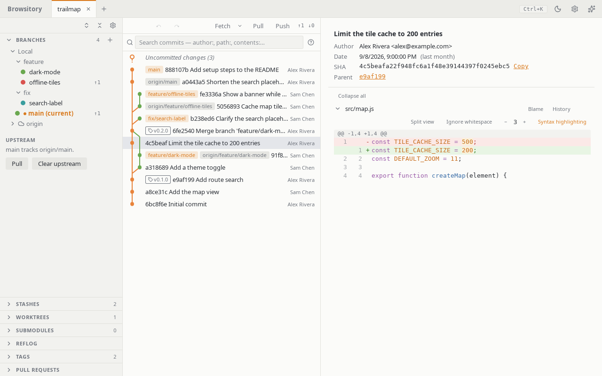

# History and diffs

Click a commit in the graph to see the files it changed and their diffs. **Blame** on a file
shows who last changed each line. Each row shows the branches and tags that point at the commit,
and the author and date (they hide when the pane is narrow). Selecting a commit shows its full
message, author, date, full SHA (**Copy** copies it) and parents above the file list; click a
parent to jump to it. The graph loads the latest 300 commits; choose **Load more** at the bottom
(or keep pressing ↓ past the last row) to load the next page. Use ↑/↓ or j/k to move through the
commits, and PageUp/PageDown to move a page at a time.

The bar above the graph has **Fetch**, **Pull** and **Push** buttons for the
current branch's upstream, with ahead/behind counts (for example `↑2 ↓1`)
based on the last fetch.

## Which branches the graph shows

At first the graph shows the commits of every local branch. In the Branches section, each branch
has a coloured dot in front of its name. Click the dot (**Show … in graph**) to add the branch to
the graph or take it out; this works for remote branches too. A branch's menu has **Isolate
branch**, which shows only that branch. **Show all branches** in the **+** menu of the Branches
section goes back to every local branch. Browsitory remembers the choice per repository.

## Image previews

A changed PNG, JPEG, GIF, WebP or SVG file shows the old and new image side by side (**Before**
and **After**) instead of a text diff, with each image's size in pixels and file size, on a
checkerboard so transparency shows. A new file shows **Added** on the left and a deleted one
**Deleted** on the right. This works in the working tree, commits, stashes and compares. Each
side is previewed up to 20 MB; a bigger one says "Too large to preview". The image type is
checked from the file's content, not its name, and a file that isn't really one of these images
says "Can't display this image". Images are only shown as pictures, so an SVG can never run a
script. An SVG is text too: **Show text diff** switches to its diff (and back with **Show
image**). A conflicted image opens the conflict pane, like any conflict.

## Diff options

The diff toolbar has four controls. **Split view** shows the old and new version side by side;
**Unified view** goes back to one column. The other three are remembered across sessions:
**Ignore whitespace**, **Context lines** (− and +, 0 to 20) and **Syntax highlighting**. While whitespace is ignored, partial
staging (lines and hunks) is unavailable in the working tree and a hint says so; staging and
unstaging whole files still works. Right after you change an option, hunk and line actions
return once the diff has reloaded with it. Highlighting covers common languages and is skipped
when a file's diff has more than 2,000 lines in total across its hunks. The command palette has
an entry for each option.
