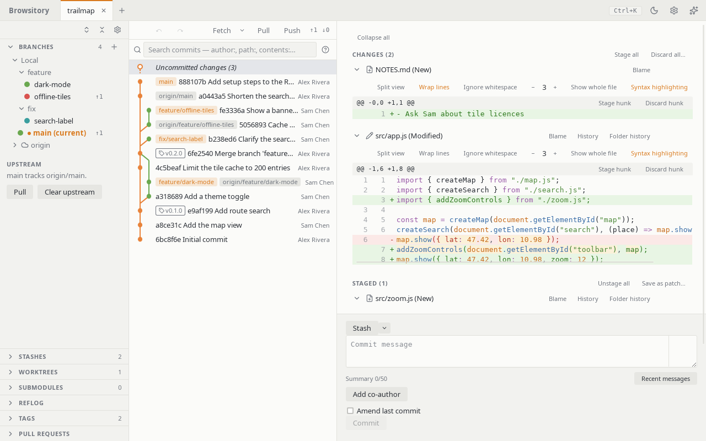
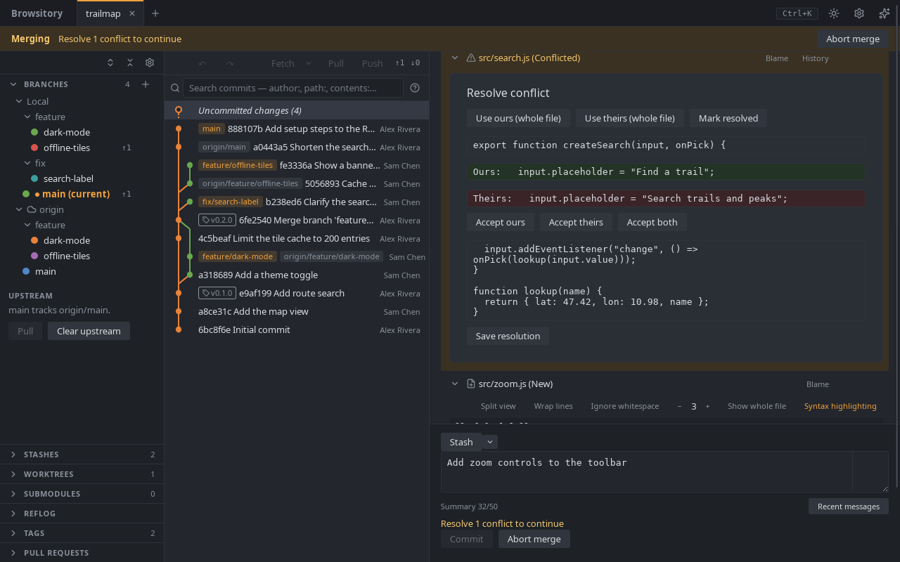

# The main window

Once a repository is open, the window has three columns:

- the **sidebar**, with the sections Branches, Stashes, Worktrees, Submodules, Reflog, Tags and
  Pull requests. Branches is open at first; the others start closed.
- the **commit graph**: your history, newest first, with **Uncommitted changes** at the top.
- the **diff pane** on the right: your working tree, or the commit you selected.

Drag the dividers between the columns to resize them. Double-click a divider to collapse the
sidebar, and again to bring it back at its width. With a divider focused, the arrow keys resize
too. The sidebar and the commit graph keep their width when you resize the window; only the
diff pane grows or shrinks. In a window too narrow for all three, the sidebar collapses by
itself and comes back once there is room.

**Sidebar sections.** Click a section's header to open or close it. The buttons at the top of
the sidebar open every section (**Expand all sections**) or close them all (**Collapse all
sections**). The gear button there lists every section except Branches with a switch, so you can
hide the ones a project doesn't use.

**Header.** The top row holds the repository tabs (see [Multiple repositories](tabs.md)) and, on
the right:

- **Ctrl+K** (**⌘K** on macOS) reminds you of the [command palette](command-palette.md) shortcut.
- The moon or sun button switches between the light and dark theme (**Switch to dark theme** /
  **Switch to light theme**). Browsitory remembers your choice. Until you pick one, it follows
  your system's setting; **Theme** under **Appearance** in **Preferences** goes back to that. In
  VSCode the button isn't there: the panel takes the colours and fonts of VSCode's own theme
  (light, dark or high contrast) and changes with it.
- The gear button opens **Preferences**: the commit message settings, **Fetch automatically**
  (see [Branches and remotes](branches-and-remotes.md#fetching-automatically)), diff word wrap
  and diff algorithm (see [Diff options](history.md#diff-options)), your editor, terminal and diff tools (see
  [External tools](external-tools.md)), the **Appearance** settings below and, in the desktop
  app, **Updates** (see below).

**Appearance.** The Appearance section of Preferences changes how the window and its text look.
Each change shows at once, without a restart:

- **Theme** (desktop app): **System** (the default) follows your system's light or dark setting,
  also when it changes while Browsitory runs; **Light** and **Dark** keep that theme. Both themes
  meet the WCAG 2.2 AA contrast levels. With a high-contrast or forced-colours setting in your
  system (such as a Windows contrast theme), Browsitory uses the system's colours, and the focus
  and the selection stay marked.
- **Code font**: the font for file content and commit IDs: diffs, blame, the file viewer,
  conflicts, and the commit message field while its ruler is shown. Type a font family name, or
  several separated by commas. A font that isn't installed falls back to the default monospace
  font; leave the field empty to use the default.
- **Code font size (px)**: the size of file content in diffs, blame, the file viewer and
  conflicts, from 10 to 24 pixels. Empty keeps each view's built-in size.
- **Interface size**: Small, Normal or Large text for the rest of the window.
- **Tab size**: how many columns a tab character takes in file content, from 1 to 16 (4 at
  first).
- The sparkle button (**What's new**) opens the **Release notes**: what changed in each version. They also open
  by themselves the first time you start a new version. The buttons at the bottom stay in view
  while you scroll: **Close** (or Escape, or a click outside the dialog) closes them, and
  **User guide** opens this guide in your browser.

**Updates (desktop app).** Browsitory checks for a new version when it starts and every six
hours, and downloads it in the background. If a check or download fails (for example while the
download server is down), it tries again after 10 minutes, then waits twice as long each time, up
to 3 hours, until a check succeeds. When it is ready, a banner says "Update v… ready".
Click **Restart to update** to install it, or keep working: nothing changes until you restart.

To stop the automatic checks, clear **Check for updates automatically** under **Updates** in
**Preferences** (it is `check_automatically = false` under `[updates]` in `config.toml`).
Browsitory then contacts the update server only when you ask: click **Check for updates** in
that section, or run **Check for updates** from the command palette. It tells you whether you
are up to date; a new version downloads and shows the same banner.
The VSCode extension updates through VSCode instead and has neither setting nor command.

The dark theme:

