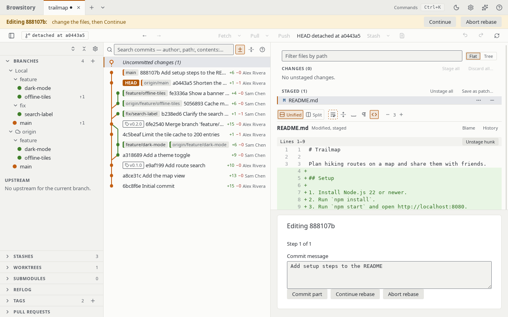

# Rewriting and moving commits

Right-click a commit in the graph:

- **Cherry-pick** applies that commit on top of your current branch (not available on the
  current HEAD commit). If it conflicts, the status strip shows **Cherry-picking**, conflicts
  resolve exactly like a merge, and **Commit** finishes it. **Abort cherry-pick** undoes it and
  keeps unrelated unstaged edits.
- **Revert** commits the inverse of that commit, with the same conflict flow (**Reverting**,
  **Abort revert**).
- **Switch to (detached)** checks the commit out without a branch. The toolbar shows **HEAD
  detached at …** and push and pull are disabled until you check out a branch. The commit's row
  in the graph has a **HEAD** badge.
- **Reset ⟨branch⟩ to here…** moves your branch to that commit. **Soft** keeps your changes
  staged, **Mixed** (the default) keeps them unstaged, **Hard** discards changes to tracked
  files; untracked files are kept. Hard asks for a second confirmation (**Reset hard**). Not
  available on a detached HEAD.
- **Reword…** on the latest commit opens the amend box with that commit's message filled in and
  the cursor in the message field. On an older commit it opens a dialog with the full message
  (see [Editing older commits](#editing-older-commits) below).

The command palette also has commands to cherry-pick, revert, check out and reset to the
selected commit, to reword, edit, squash, fixup, move or drop it (**Reword 1a2b3c4…**, **Drop
1a2b3c4** and so on), and to amend the last commit (where the commit menu offers them), plus
**Continue cherry-pick** / **Abort cherry-pick** (or revert) while a sequence is paused.

??? note "Details"
    A pick is refused if it would overwrite unstaged edits or if changes are staged. Picking a
    commit whose changes are already on the branch reports "Nothing to apply — those changes are
    already on this branch." On a merge commit the item reads **Cherry-pick…** and asks which
    parent to apply it against: parent 1 is usually the branch that was merged into, so picking
    against it applies what the merge brought in. On a merge commit, **Revert…** asks for the
    parent to keep (parent 1 undoes what the merge brought in), and the message names it like
    `git revert -m` does.

    Cherry-pick, revert, check out, reset and **Create tag at…** also work for a commit selected
    in the search results or a file history that is older than the history loaded in the graph;
    the history edits need the commit in the graph, so load more history (or use **Go to
    commit…**) first.

## Amending the last commit

Tick **Amend last commit** under the commit message. The message fills with the last commit's,
and the **Commit** button becomes **Amend** (the commit button's arrow has **Amend last commit**
too): anything staged is folded into that commit (or just reword it). If that commit is already
on the upstream, a warning reads "Already pushed — you'll need to force push." Whatever you had
half-typed is kept and comes back when you untick amend or after a successful amend.

An **Author** field shows the commit's author as `Name <email>`. Leave it as it is (or empty) to
keep the author, or change it to give the commit a different author; the original author date is
kept and you stay the committer. It must have the form `Name <email>`. Co-authors work here too;
amend starts without the chips you added for your next commit and gives them back afterwards.

## Editing older commits

The commit menu has eight one-click edits for commits of the current branch:

- **Reword…** changes the commit's message.
- **Edit commit…** stops at the commit with its changes staged on its parent. The status strip
  says "Editing 1a2b3c4: change the files, then Continue". Change, stage or unstage files, edit
  the message in the commit area if you like, then **Continue**: the staged result is committed
  with that message (and the commit's author), and the commits after it are replayed.
  **Abort rebase** puts the branch back as it was.
- **Split commit…** stops the same way, to commit the changes as several commits. Unstage what
  belongs in a later commit, write the first commit's message in the commit area (it offers the
  original one) and click **Commit part**; the box is then empty for the next part. Stage the
  next part, write its message, and so on. **Continue** commits what is still staged as the
  last part, or nothing more when every change went into a part, then replays the commits after
  it. Every part keeps the original commit's author. The status strip says "Splitting 1a2b3c4:
  commit each part, then Continue". Edit commit… has **Commit part** too.
- **Squash with parent** combines the commit with the one below it. The result keeps the
  parent's author and has both messages, the parent's first.
- **Fixup into parent** combines them too, but keeps only the parent's message.
- **Move up** and **Move down** swap the commit with the newer or the older neighbour.
- **Drop** removes the commit and its changes from the branch.

Each one is a small interactive rebase (see [Rebase](rebase.md)): the commits after the edited
one are rewritten, so they get new ids. A conflict pauses it like any rebase: the progress panel
shows **Continue rebase** and **Abort rebase**, the paused rebase survives a restart, and Abort
puts the branch back as it was. A finished edit is one **Undo** step named after the edit
("Drop 1a2b3c4", "Squash 1a2b3c4 into its parent", "Move 1a2b3c4 up", "Edit 1a2b3c4",
"Split 1a2b3c4").

**Changes left over when you continue.** At an edit stop, **Continue** commits only what is
staged. When a tracked file still has changes that aren't staged, or a file the commit added is
no longer staged, Continue asks what to do with them: **Commit the rest** stages them and
commits them with the commit (the last part of a split), **Discard the rest** throws them away
(the history then doesn't have them; Undo of the whole edit brings them back), or **Cancel** to
go back and stage what belongs where. Untracked files of your own don't count. When nothing
of the commit is left (nothing staged, and nothing unstaged either), Continue drops the commit,
as **Drop** would; **Undo** brings it back.

**Fold staged changes into this commit.** While you have changes staged, the commit menu (and
the palette) also offers to fold them into a commit of the current branch, like `git commit
--fixup` followed by `git rebase --autosquash`. The commit keeps its message and author, and the
commits after it are replayed; on the latest commit this simply amends it. A conflict with a
later commit pauses it like any rebase, and **Abort rebase** puts the branch back with your
changes staged again. It is one **Undo** step ("Fold staged changes into 1a2b3c4"). Like the
other edits it needs a clean tree apart from the staged changes: unstaged changes to tracked
files have to be staged or stashed first (untracked files are fine). It runs no commit hooks.

??? note "Details"
    An edit is disabled, with the reason as its tooltip, when:

    - the commit isn't on the current branch (or HEAD is detached);
    - it is a merge commit, or a merge commit comes after it (use **Rebase onto here…**
      instead);
    - it is the first commit of the history; Squash, Fixup and Move down also need a parent
      that isn't the first commit or a merge commit;
    - Move up is on the latest commit;
    - you have staged changes or changes to tracked files (untracked files are fine), as for any
      rebase: commit or stash them first (Fold staged changes needs staged changes, and no
      unstaged changes to tracked files);
    - a merge, cherry-pick, revert or rebase is in progress, here or in a terminal.

## Force push

When a push is rejected because the remote has commits you don't, the error offers **Force push
(with lease)…**. The command palette has it too, as **Force push current branch…** in the
Remotes group; it is hidden on a detached HEAD or when the branch has no upstream. It always
asks for confirmation.

??? note "Details"
    The push is refused if the remote branch changed since your last fetch ("⟨remote⟩/⟨branch⟩
    changed since your last fetch. Fetch and review before force pushing."). Like `git push
    --force-with-lease`, a fetch between reviewing and pushing refreshes the lease, so review the
    remote branch after your last fetch, not before.

## Cherry-picking or reverting several commits

Select commits with Ctrl/Cmd+click or Shift+click, then **Cherry-pick N commits** or **Revert N
commits** (in the right-click menu and the bar under the graph). The order you select them in
doesn't matter: cherry-picks apply oldest first, reverts newest first (like `git revert A..B`).
Each commit keeps its own message and author.

**Dragging commits onto a branch.** Drag a commit from the graph onto the current branch in the
sidebar's Branches section to cherry-pick it there. On release a small menu offers
**Cherry-pick ⟨commit⟩ onto ⟨branch⟩** and **Cancel**. Dragging a commit of a multi-selection
drags the whole selection (**Cherry-pick N commits onto ⟨branch⟩**, oldest first). The commit
menu and the bar under the graph offer the same actions without dragging.

A conflict pauses the sequence: the status strip shows "Cherry-picking 2/5" and the commit area
shows **Continue cherry-pick** / **Abort cherry-pick** instead of the message box. Resolve the
conflicts (see [Resolving conflicts](conflicts.md)), then **Continue**; it commits the resolved
step and goes on. **Abort** puts the branch back where it was before the first commit was
applied, keeping unrelated uncommitted edits. A whole sequence is one **Undo** step; an aborted
one leaves nothing to undo.

??? note "Details: selecting and dragging"
    A commit whose changes are already on the branch is skipped, and the result says so
    ("Cherry-picked 2 commits, skipped 1 with no changes"). Reverting a revert is called
    "Reapply …", as in git. Merge commits have to be picked one at a time, so the actions are
    disabled when the selection holds one.

    While you drag, a label beside the pointer says what the drop does, and the branch under the
    pointer is highlighted. A merge commit's item reads **Cherry-pick ⟨commit⟩ onto ⟨branch⟩…**
    and opens the parent picker. The same rules as the menu items apply: a cherry-pick lands on
    the current branch, so any other branch refuses the drop, as do a detached HEAD, the HEAD
    commit itself, a selection with a merge commit and a repository busy with another
    operation; the label says why. A collapsed folder opens when you hold the commit over it
    for a moment. Escape cancels the drag.

??? note "Details: a paused sequence"
    If you resolve a step so that nothing is left to commit (for example **Use ours (whole
    file)** on its only change), that step is skipped. A sequence that stops for another reason
    (say an untracked file is in the way) also shows **Continue**, which retries the step. The
    paused sequence is kept on disk, so it is still there after you close and reopen the app.
    While it is paused, other cherry-picks, merges, rebases, commits, amend, reset, checkout,
    branch switching, pull and stash apply/pop are unavailable, and so are saving a stash and
    deleting, renaming or adding a worktree on the branch the sequence runs on. While that
    worktree is still on the branch, the windows of the repository's other worktrees can't move,
    delete, rename or switch to it either, or add a worktree on it ("branch 'main' has a paused
    cherry-pick in another worktree at …"). Unlike git, this includes renaming, so the paused
    sequence keeps its branch under the name it started with.

    If you finish a conflicted step yourself in a terminal (`git commit` after resolving),
    **Continue** recognises it when it is exactly that step: one commit on top of where the
    sequence stopped, with the picked commit's author, message and changes (for a cherry-pick)
    or git's "This reverts commit …" message (for a revert). Any other commit, or any commit
    after a stop that wasn't a conflict, means HEAD moved, and Continue refuses.

    If HEAD was moved elsewhere in the meantime (for example by a commit, reset or branch switch
    in a terminal), Abort only ends the sequence and leaves HEAD and every branch alone, and says
    so. If HEAD is on another commit than where the sequence stopped, Continue refuses too.
    Renaming the branch in a terminal (`git branch -m`) doesn't count as moving HEAD: Continue
    carries on on the renamed branch, and, as with `git cherry-pick --abort`, Abort puts the
    renamed branch back. The step **Continue** commits runs the commit hooks (see
    [Hooks](hooks.md)); the steps applied by themselves run none, like a single cherry-pick.

## Started in a terminal

If a `git cherry-pick A B C` (or `git revert A B`) from a terminal stops on a conflict, you can
resolve it and commit the step from Browsitory's commit box. Like `git commit`, this keeps git's
list of the remaining commits, so `git cherry-pick --continue` (or `git revert --continue`)
carries on with them.

While a `git bisect` runs, a bar says **Bisecting (started from main)** and "Use git bisect good,
bad or reset in a terminal." It has no buttons: you end the bisect in the terminal.

??? note "Details: a cherry-pick or revert started in a terminal"
    The list is removed only after its last commit. A squash merge in Browsitory keeps such a
    list too. Committing also no longer ends a `git bisect` started in a terminal, as with `git
    commit`.

    While such a list is paused, the bar shows it. On a conflict it says **Cherry-picking
    (started in a terminal)** (or **Reverting …**). Between two commits (after you committed a
    step, or when git stopped on an error) it says **Cherry-pick paused in a terminal** and "Run
    git cherry-pick --continue there to apply the remaining commits." Continue it in the
    terminal. Until it is finished, cherry-pick, revert (one commit or several) and rebase in
    Browsitory say "A cherry-pick started in a terminal isn't finished. Continue it there with
    git cherry-pick --continue, or abort it first." git itself allows a single cherry-pick here;
    Browsitory refuses it so that Abort always knows which commits belong to the list. Merge,
    commit, amend, reset, checkout and stash still work, and they keep the list.

    **Abort cherry-pick** (or **Abort revert**) in the bar, the commit box or the palette works
    like `git cherry-pick --abort`. It discards the paused step's changes and your conflict
    resolutions, and keeps other edits. If HEAD is still where the list left it, it also removes
    the commits the list made and puts the branch back where the list started. It asks first:
    "Abort the whole cherry-pick? This also removes the 2 commits it made and puts the branch
    back at 1a2b3c4 "X". The paused step's changes and conflict resolutions are discarded; other
    uncommitted changes stay." If more than 1000 commits would go, it says "more than 1000". If
    you moved HEAD since (for example by committing a step yourself), HEAD stays where it is, as
    with git, and the toast says so. Either way the list ends.

    Like git, Abort checks everything first and changes nothing when it would lose work:

    - a file you changed (or an untracked file) is where putting the branch back would write:
      "Abort can't put the branch back: 'f' has changes it would overwrite. …";
    - a file of the paused step that you staged and then changed again: "Abort would discard
      your changes to 'f'. …" (Abort merge says the same in that case);
    - the list changed since you confirmed (the terminal went on): "The cherry-pick in the
      terminal changed since you looked. Check it again, then abort.";
    - git's own files for the list are damaged: Abort says which one, and that `git cherry-pick
      --quit` in a terminal ends the list without moving HEAD.

    Save or discard the change and try again. Abort can't be undone with **Undo**, but the
    removed commits are still in the reflog. **Abort** of a merge started during such a list
    removes only the merge, as git does.

??? note "Details: a bisect started in a terminal"
    As with git, you can cherry-pick, revert, rebase, reset, amend, commit, and use Undo and
    Redo, and none of them ends the bisect. Only the branch the bisect started from is
    protected, because `git bisect reset` returns to it. As with git, it can't be restored from
    the reflog, deleted, renamed or checked out in a new worktree, from any worktree's window
    ("branch 'main' is being bisected in this worktree"). Undo doesn't move it either. Switching
    to it is allowed in this worktree, but not from another one. A commit made while HEAD is
    detached by the bisect is not on any branch: `git bisect reset` leaves it behind (it is
    still in the reflog).
