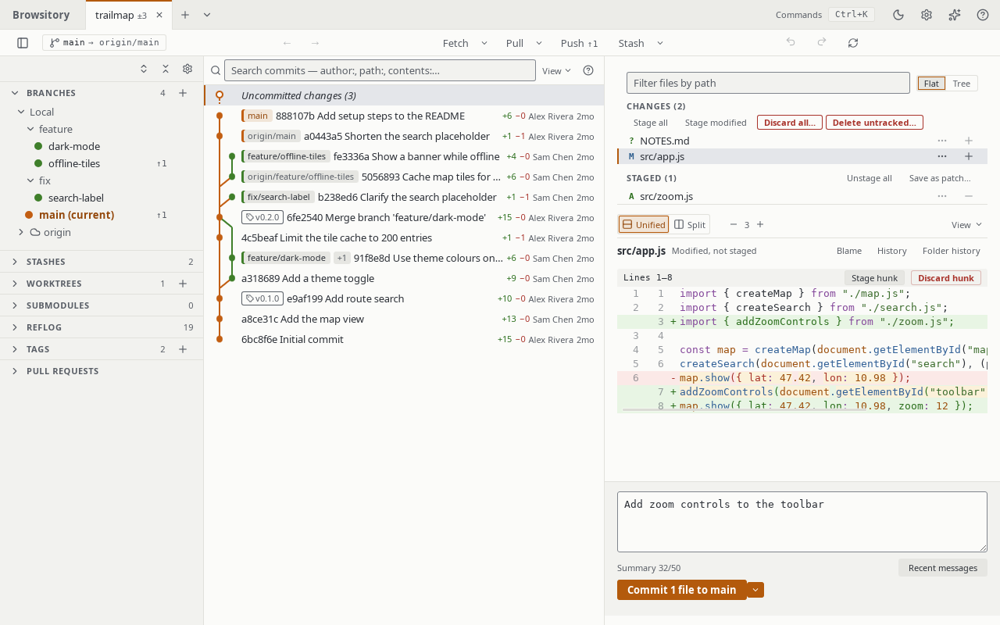
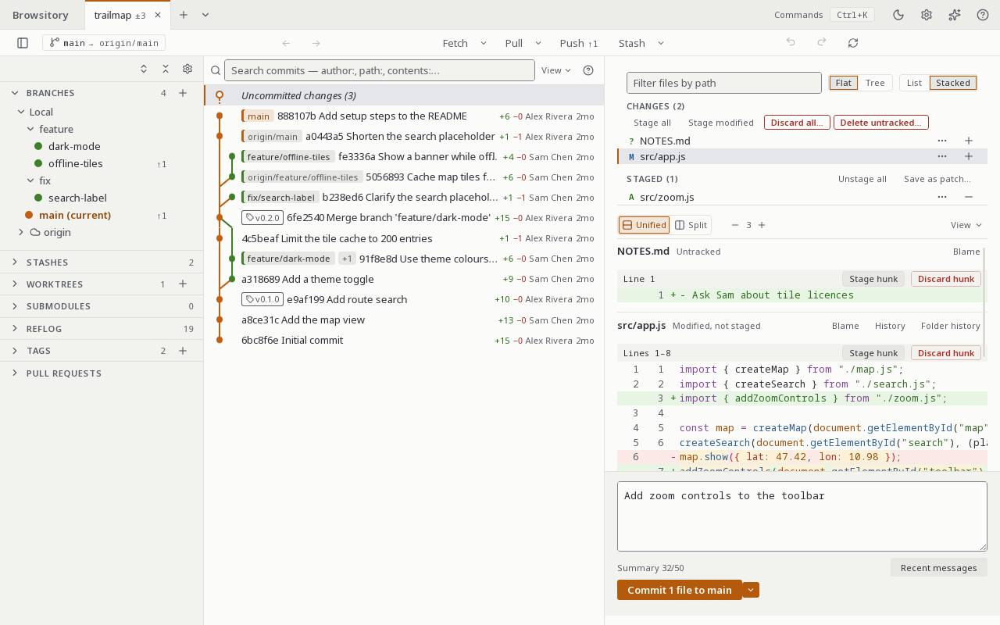

# Staging and committing

Select **Uncommitted changes** at the top of the commit graph to see your working tree in the
right-hand pane. At the top is a compact list of the changed files in two groups, **Changes** and
**Staged**; below it, one diff viewer shows the current file, or with **Stacked** every file's
diff one below the other (see [All diffs at once](#all-diffs-at-once)).

To commit:

1. Stage what goes into the commit: the stage button on a file's row, **Stage all** above the
   **Changes** group, or **Stage hunk** in the diff. **Unstage** on a **Staged** row takes a
   file back out.
2. Type a commit message. Until you click into it, the commit box at the bottom is one line
   with **Commit** beside it, so the diff above keeps the room; it opens fully while it has the
   focus or holds a message.
3. Click **Commit**. The button says what it commits and where, for example **Commit 3 files to
   main** (without the branch on a detached HEAD).

After a commit a notification names it, "Committed 4c5beaf to main", with **Push** to push the
branch (to its upstream, or through the Push dialog when it has none) and **Undo**; without a
remote it has **Undo** only. The arrow next to **Commit** has **Commit and push**, which commits
and then pushes the same way, **Amend last commit**, which turns on amend mode (see
[Rewriting commits](rewriting-commits.md)), and **Add co-author…** (see below). **Stash** in the repository toolbar sets the current
changes aside; see [Stashes](stashes.md).

??? note "Details"
    Without a message **Commit** is disabled, and "Write a commit message to commit." says why.
    With nothing staged it says "Stage changes to commit.", or "Nothing to commit." when the
    working tree is clean. The arrow's menu works without a message.
    The notification's **Push** only pushes the branch it names: if you have checked out another
    branch since, it says "Not pushed: main is no longer the current branch." instead. **Undo**
    only acts while that commit is still the latest. **Commit and push** needs a branch and a
    remote; otherwise its tooltip says why.

    A commit that fails, for example because a hook rejected it, keeps its message in the box,
    so you can fix it and commit again without retyping it.

    When nothing has changed, the pane says **Working tree clean** instead. In a new repository
    without commits it says **No commits yet**: add files to the repository folder, stage them
    and commit to make the first commit.

## The file list

Both groups are always on screen: each scrolls on its own when it holds many files, and an empty
one says so. Each row shows a status letter (**M** modified, **A** added, **?** untracked, as in
`git status --short`, **D** deleted, **R** renamed, **T** type changed, **C** conflicted; hover it
for the word), the path, a **⋯** menu and a stage or unstage button. The two buttons are always
there, in a muted colour that brightens when you point at them. Above the diff, the file's state
reads **Untracked**, **Modified, not staged** or **Added, staged**.

A new folder with more than 500 files that git doesn't ignore (a `node_modules` or build output
not yet in `.gitignore`) is one row, **untracked folder, more than 500 files**, instead of one row
per file; smaller new folders are listed file by file. The row's arrow (or **→** and **Enter**)
lists the folder's files under it, **←** hides them again. Selected, the folder shows **Stage
folder**, **Ignore folder** and **Delete folder…** instead of a diff; `s`, its **⋯** menu,
**Stage all** and **Delete untracked…** act on all its files. While the folder is collapsed, a
change inside it doesn't refresh the list; listing its files, or **Refresh**, reads them again.

When **Changes** holds both changes to tracked files and untracked (new) files, **Stage
modified** sits next to **Stage all**: it stages the tracked files' changes (edits, deletions,
type changes) and leaves the untracked files where they are, like `git add -u`. **Stage all**
stages the untracked files too. Both leave conflicted files alone, and each is one undo step.
The command palette has the same actions as **Stage all changes** and **Stage modified files
(tracked only)**; **Ctrl+Shift+A** (**⇧⌘A** on macOS) stages all changes from anywhere outside a
text field.

**Filter files** above the groups narrows both lists to the files whose path contains what you
type (upper and lower case alike; Escape clears it), and the group headings count what is shown
("Changes (2 of 14)").

**Flat** and **Tree** next to the filter switch the layout. The tree groups the files by folder,
folders first; a chain of folders that only hold one folder shows on one row (`src/lib`). Click
a folder, or press Left and Right on it, to collapse and expand it; the arrow keys then skip its
files. The **+** or **−** on a folder stages or unstages all its files (conflicts are left out,
as with **Stage all**). Conflicts stay in their own flat list above the tree. Like the flat list,
the tree draws only the rows on screen, so thousands of changed files scroll smoothly. The layout is
remembered on this computer for every repository, and **Preferences → Diff → Show changed files
as a tree** sets it too.

??? note "Details"
    While the filter hides files, the group buttons act on the shown files only and say so:
    **Stage 3 shown**, **Stage 2 modified shown**, **Discard 3 shown…** and **Delete 1 untracked
    shown…** (whose confirmations list exactly those files) and **Unstage 2 shown**. Ctrl+A (⌘A
    on macOS) selects the shown files, and a filter change drops hidden files from a selection,
    so no action ever reaches a file you can't see. The command palette's **Discard all
    changes…** and **Delete untracked files…** still act on every file. **Save as patch…** saves
    every staged change, the hidden ones too.

    A rename you staged (`git mv`, or staging both the deletion and the new file) is one
    **Staged** row under the new name with "Renamed from …": its diff shows only the edits, an
    image previews the old version against the new one, and unstaging it unstages both names. A
    file moved on disk but not staged yet shows as deleted plus new, like `git status`.

    In a sparse checkout (`git sparse-checkout`), the files outside the chosen folders aren't
    on disk and aren't listed, as with `git status`; the same for a file you marked with `git
    update-index --skip-worktree` (a local configuration file you keep edited). Such a file
    can't be staged, as `git add` refuses it. A file added with `git add -N` (intent to add) is
    listed under **Changes** with **A** (added, not staged), as `git status` shows ` A`, until you
    stage it, and a commit leaves it out, as `git commit` does. **Stage modified** stages it, as
    `git add -u` does; **Discard changes…** empties it, as `git restore` does (its staged
    version is empty), and **Delete untracked…** leaves it alone.

    A file name with `[`, `]`, `*` or `?` in it (`pages/[id].tsx`) is just a name: staging,
    unstaging or discarding it never touches the other files the name would match as a pattern.

## The diff viewer

The viewer shows the current file: the first one when you open the view, or the one you click.
Its header names the file and has **Blame** (who last changed each line) and **History**. When
the current file leaves its group, for example because you staged it, the file now in its place
becomes current.

Each hunk header has the buttons **Stage hunk** (or **Unstage hunk**) and **Discard hunk**,
which is red; their keys are `s` and `d`. Discard doesn't ask: the hunk goes at once, and the
notification that says so has an **Undo** button (Ctrl+Z, ⌘Z on macOS, works too).

The options above the viewer (**Unified view** / **Split view**, the context lines, and in the
**View** menu **Wrap lines**, **Show whole file**, **Ignore whitespace**, **Show whitespace** and
**Show syntax highlighting**) apply to every file and are remembered; see
[Diff options](history.md#diff-options).

??? note "Details"
    Only the current file's diff is loaded (in the stacked view, the diffs near what is on
    screen). To keep large new or generated files from loading
    when you move onto them, turn off **Preferences → Diff → Expand untracked files**: an
    untracked file then shows **Show contents** (and **Diff preferences**, which opens that
    setting) in the viewer and loads only when you press it (it stays shown when the list
    refreshes); changes to tracked files always load at once.

## All diffs at once

To read every change before you commit, click **Stacked** next to **Flat** and **Tree**: the
viewer gives way to every listed file's diff, one below the other, Changes first and then
Staged, each under a header with the file's name, **Blame** and **History**. **List** goes back
to the one viewer. The choice is remembered on this computer for every repository, and
**Preferences → Diff → Show all diffs stacked** sets it too.

The file list stays above the diffs as an index: click a file (or move to it with the arrow keys)
and the stack scrolls to its diff; **Enter** puts the focus in that diff. With the focus in a
diff, `j` and `k` go to the next and previous file's diff. Every diff has the same hunk and line
actions as the one viewer: **Stage hunk**, **Unstage hunk**, **Discard hunk**, and staging or
discarding selected lines. The filter and a collapsed folder in the tree leave their files out
of the stack too. Screen readers find each file by its heading.

??? note "Details"
    A diff loads when it scrolls near the view, and stays shown after that; when the files
    change, the diffs on screen load again at once and the others when you scroll back to them.
    The stack holds 100 files at first: below the last one, **Show 100 more** adds the next 100,
    and a file further down that you pick in the list adds every file up to it. Large and
    generated files show collapsed, as in the one viewer.

    A conflicted file shows its merge editor in the stack, among the other diffs; the file list
    doesn't shrink to the conflicts as it does when you open a conflict in the list view.

## Selecting several files

Click a file's row to select it. **Ctrl+click** (**Cmd+click** on macOS) adds a file to the
selection or removes it, and **Shift+click** selects every file from the last one clicked.

With two or more files selected, a bar above the list shows how many and offers **Stage N
files** (or **Unstage N files**), **Discard N files…**, **Ignore N untracked files** (when the
selection has untracked files) and **Stash N files…**; `s`, a selected file's **⋯** menu and
the command palette offer the same actions.

??? note "Details"
    With the **Changes** or **Staged** list focused, `↑`/`↓` (or `j`/`k`) move to the next file
    and on into the other list past either end, `Shift+↑`/`Shift+↓` extend the selection,
    **Ctrl+A** (**⌘A**) selects the whole list, **Esc** keeps only the current file and
    **Enter** moves the focus into its diff. With the focus in the diff, `j` and `k` go to the
    next and previous file and keep the focus there. A selection stays within one list: clicking
    a file in the other list starts a new one. The current file, marked by a bar on its left, is
    the one the viewer shows; screen readers announce how many files are selected.

    **Discard N files…** asks once for all of them and is one step for **Undo**. **Ignore** adds
    each untracked file to `.gitignore` as **Ignore file** does. Staging, unstaging or ignoring a
    selection (like **Stage all** and **Unstage all**) is one step for **Undo** too ("Stage 3
    files", "Ignore 2 patterns"), and the notification after **Ignore** has an **Undo** button.
    If one of the files can't be staged or unstaged, none of them is, and the error names why.
    Conflicted files in a selection are left out of these actions, as **Stage all** leaves them
    out. While another action is running, the bar's buttons are disabled.

## Writing the commit message

**Alt+C** (**⌥C** on macOS), or **Go to commit message** in the command palette, shows the
working tree and puts the cursor in the message from anywhere outside a text field.

Below the message (once the box is open), **Summary 42/50** counts the characters of the first
line. Past the limit it
turns to a warning color, because many tools cut longer summaries; it never stops a commit. A
faint dotted ruler marks column 72 for wrapping the body. Change the limit, the ruler column
(both 10 to 200) or turn the ruler off under **Preferences → Commit message**.

**Add co-author…** in the menu of the arrow next to **Commit** lists the authors of the last
1,000 commits on the current branch (newest first, without you); type to filter, or type a new
`Name <email>` and press Enter. Each
co-author shows as a chip (× removes it) and is added to the message as a `Co-authored-by: Name
<email>` trailer when you commit.

The message you are writing, with its co-authors, is kept per repository on this computer
until you commit or clear it: it comes back after a tab switch, closing and reopening the tab,
quitting the app, closing the VSCode panel or reloading the window.

**Recent messages** (next to the counter) opens a menu of earlier messages. Use the arrow keys
and Enter, or click, to put that full message in the box; it replaces what was there. **Ctrl+Z**
(**⌘Z** on macOS) in the field, or **Restore message**, brings back the replaced text until you
edit the field.

??? note "Details"
    The field uses a monospace font while the ruler is shown, so the column lines up.

    Co-author trailers go after any trailers the message already ends with, and never twice. The
    chips stay until the commit lands, so a failed hook keeps them, and **Commit without hooks**
    uses them too. They are hidden while a merge, cherry-pick or revert pre-fills the message.

    **Recent messages** lists first the last 20 messages you committed or amended in Browsitory
    in this repository (newest first; kept per repository on this computer, not in the
    repository), then the 10 newest commits on the current branch, each summary once. A merge,
    cherry-pick, revert or squash message that git wrote and you committed unchanged is not
    kept.

**Your name and email.** Git records a name and an email address with every commit
(`user.name` and `user.email`). When none is set, committing (or amending) opens **Set your git
identity** instead of failing with git's error: enter both, choose **All repositories** (your
global git config, as `git config --global` does) or **This repository only**, and **Save and
commit** commits what you were committing. After an amend, the dialog only saves; amend again.

## Staging individual lines

In a diff, select lines by clicking one, Shift+clicking to extend, Ctrl/Cmd+clicking to add or
remove one, or dragging across several. Then use **Stage lines**, **Unstage lines** or **Discard
lines** in the hunk header. `s` stages or unstages and `d` discards the selection, or the whole
hunk when nothing is selected.

??? note "Details"
    A selected line has a bar on its right edge (the line cursor's bar is on the left) and keeps
    its added or removed colour. With the keyboard, `↑`/`↓` move a line cursor inside the active
    hunk and select that line (the diff scrolls to keep it in view), `Shift+↑`/`Shift+↓` extend
    the selection, and `[` / `]` jump to
    the previous or next hunk (which clears the selection). A screen reader reads the line under
    the cursor, whether it is added or removed, its number and whether it is selected (see
    [Diff options](history.md#diff-options)).

    If the file changed since its diff was shown (for example you edited it in another editor),
    line actions don't run; the diff refreshes so you can select again. Discarding a whole hunk
    of an untracked file empties the file rather than deleting it. Staging, unstaging or
    discarding a hunk or lines keeps the file's mode (such as the executable bit), as `git add
    -p` does, and doesn't stage or undo a mode change; stage or discard the whole file for that.

## Discarding and ignoring files

Open a file's **⋯** menu, right-click the file row, or press Shift+F10 (or the Menu key) with
the file row focused, for **Discard changes…**. A confirmation dialog appears. A discard can be
reverted with **Undo** (see [Undo and redo](undo-redo.md)) unless the file is changed again
afterwards. Staged files don't offer discard; unstage them first.

**Discard all…** next to **Stage all** discards the unstaged changes of exactly the files its
confirmation lists. It deletes untracked files and skips conflicted ones. When **Changes** has
untracked (new) files, **Delete untracked…** sits next to it: it deletes only the untracked
files and keeps every change to tracked files, conflicts and ignored files. Its confirmation
names how many files go and lists the first five. The command palette has it as **Delete
untracked files…**, and **Discard all…**'s confirmation points to it when untracked files would
be deleted along with the rest.

For untracked files the menu also offers ignore items. Each appends a pattern to the
repository's `.gitignore` (creating it if needed). **Ignore file** is always offered. **Ignore
all \*.ext** appears only when the file name has an extension. **Ignore folder ⟨folder⟩/**
appears only when the file is in a subfolder. The pattern names exactly that file or folder:
characters that `.gitignore` reads as a pattern (`[`, `*`, `?`, `\` and trailing spaces) get a
backslash, so ignoring `pages/[id].tsx` writes `/pages/\[id].tsx`, which doesn't ignore
`pages/i.tsx`.

??? note "Details"
    You can discard while a merge, rebase, cherry-pick or revert is paused, to resolve it; while
    another action or a fetch, pull or push is running, the confirmation's button is disabled
    and the dialog says why. The same goes for **Discard all…** and **Delete untracked…**.
    Folders, such as an untracked nested repository, are never deleted by either; any file that
    couldn't be discarded is named in an error after the rest are done.

    Discarding never writes or deletes outside the repository, including through a symlinked
    folder. If a tracked file was replaced by a symbolic link, discarding removes the link and
    restores the file (the link's target is never touched), like git; reset, undo/redo,
    aborting a merge or rebase and resolving a conflict do the same. If a tracked folder was
    replaced by a file of the same name, discarding a file that was in the folder, or a hunk or
    lines of it, refuses and names the file in the way ("Couldn't discard 'd/f': 'd' is now a
    file, not a folder. Discard or move 'd' first."), also when the folder was further up;
    **Discard all** with both the file and the folder's files deletes the file first and then
    restores the folder. If a tracked file was replaced by a folder, discarding the file deletes
    the untracked files in the folder, like git, and Undo brings them back; if the folder holds
    anything Undo can't bring back (an ignored file or a nested repository), the discard refuses
    and names it ("Couldn't discard 'd': it is now a folder holding 'd/x.log', which Undo can't
    bring back. Move it first."), and **Discard all** leaves the folder's untracked files alone
    too.

    A `.gitignore` that is a symlink is left alone and reported. If `.gitignore` is read-only,
    the ignore items change nothing and say "'.gitignore' is read-only. Make it writable, then
    try again." `.gitignore` is replaced whole, so a failed write leaves it as it was. On
    Windows, if another program keeps `.gitignore` open so it can't be replaced, the ignore
    items say "'.gitignore' is open in another program. Close it, then try again." and change
    nothing.
