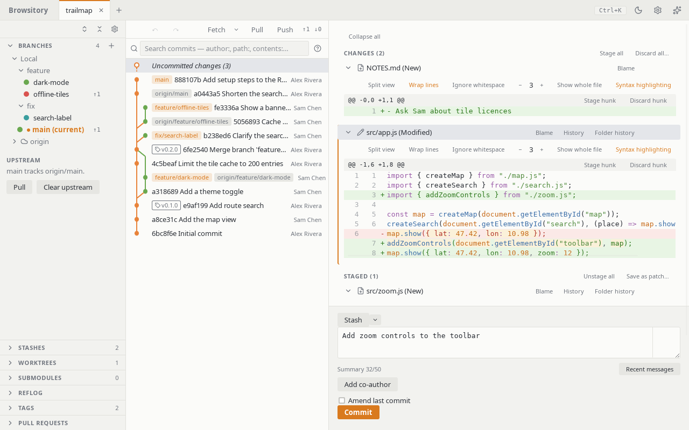

# Staging and committing

Select **Uncommitted changes** at the top of the commit graph to see your working tree in the
right-hand pane. It has two groups, **Changes** and **Staged**, each with **Stage all** or
**Unstage all**. Every file shows its diff. Hover a file to show its stage or unstage button, or
use **Blame** to see who last changed each line. Type a commit message and click **Commit**.
**Stash** sets the current changes aside; see [Stashes](stashes.md).

Each hunk header has **Stage hunk** (or **Unstage hunk**) and **Discard hunk**. Discard asks once
more: the button turns into **Confirm discard**, and a second click discards the hunk.

A rename you staged (`git mv`, or staging both the deletion and the new file) is one **Staged**
row under the new name with "Renamed from …": its diff shows only the edits, an image previews
the old version against the new one, and unstaging it unstages both names. A file moved on disk
but not staged yet shows as deleted plus new, like `git status`.

## Selecting several files

Click a file's header to select it. **Ctrl+click** (**Cmd+click** on macOS) adds a file to the
selection or removes it, and **Shift+click** selects every file from the last one clicked. With
the **Changes** or **Staged** list focused, `↑`/`↓` move to the next file, `Shift+↑`/`Shift+↓`
extend the selection, **Ctrl/Cmd+A** selects the whole list and **Esc** keeps only the current
file. A selection stays within one list: clicking a file in the other list starts a new one.
Clicks inside a diff select lines there, not files. The current file (marked by a bar on its
left) is the one the pane scrolls to; screen readers announce how many files are selected.

With two or more files selected, a bar above the list shows how many and offers **Stage N
files** (or **Unstage N files**), **Discard N files…**, **Ignore N untracked files** (when the
selection has untracked files) and **Stash N files…**; `s`, a selected file's **⋯** menu and
the command palette offer the same actions. **Discard N files…** asks once for all of them and
is one step for **Undo**. **Ignore** adds each untracked file to `.gitignore` as **Ignore file**
does. Staging, unstaging and ignoring a selection (like **Stage all** and **Unstage all**) record
one undo step per file. Conflicted files in
a selection are left out of these actions, as **Stage all** leaves them out. While another
action is running, the bar's buttons are disabled.

## Writing the commit message

Below the message, **Summary 42/50** counts the characters of the first line. Past the limit it
turns to a warning color, because many tools cut longer summaries; it never stops a commit. A
faint ruler marks column 72 for wrapping the body, and the field uses a monospace font while the
ruler is shown so the column lines up. Change the limit, the ruler column (both 10 to 200) or
turn the ruler off under **Preferences → Commit message**.

**Add co-author** lists the authors of the last 1,000 commits on the current branch (newest
first, without you); type to filter, or type a new `Name <email>` and press Enter. Each co-author
shows as a chip (× removes it) and is added to the message as a `Co-authored-by: Name <email>`
trailer when you commit, after any trailers the message already ends with and never twice.
The chips stay until the commit lands, so a failed hook keeps them, and **Commit without hooks**
uses them too. They are hidden while a merge, cherry-pick or revert pre-fills the message.

**Recent messages** (next to the counter) opens a menu of earlier messages: first the last 20
you committed or amended in Browsitory in this repository (newest first; kept per repository on
this computer, not in the repository), then the 10 newest commits on the current branch, each
summary once. Use the arrow keys and Enter, or click, to put that full message in the box; it
replaces what was there. **Ctrl+Z** (**Cmd+Z** on macOS) in the field, or **Restore message**,
brings back the replaced text until you edit the field. A merge, cherry-pick, revert or squash
message that git wrote and you committed unchanged is not kept.

A commit that fails, for example because a hook rejected it, keeps its message in the box, so
you can fix it and commit again without retyping it.

## Staging individual lines

In a diff, select lines by clicking one, Shift+clicking to extend, Ctrl/Cmd+clicking to add
or remove one, or dragging across several. Then use **Stage lines**, **Unstage lines** or
**Discard lines** in the hunk header. With the keyboard, `↑`/`↓` move a line cursor inside the
active hunk and select that line, `Shift+↑`/`Shift+↓` extend the selection, and `[` / `]` jump
to the previous or next hunk (which clears the selection). `s` stages or unstages and `d` `d`
discards the selection, or the whole hunk when nothing is selected.

If the file changed since its diff was shown (for example you edited it in another editor),
line actions don't run; the diff refreshes so you can select again. Discarding a whole hunk of
an untracked file empties the file rather than deleting it. Staging, unstaging or discarding a
hunk or lines keeps the file's mode (such as the executable bit), as `git add -p` does, and
doesn't stage or undo a mode change; stage or discard the whole file for that.

## Discarding and ignoring files

Open a file's **⋯** menu, right-click the file header, or press Shift+F10 (or the Menu key)
with the file row focused, for **Discard changes…**. Staged files don't offer discard; unstage them first. A confirmation dialog
appears. A discard can be reverted with **Undo** (see [Undo and redo](undo-redo.md)) unless the
file is changed again afterwards. **Discard all…** next to **Stage all** discards
the unstaged changes of exactly the files its confirmation lists. It deletes untracked files
and skips conflicted ones. Folders, such as an untracked nested repository, are never deleted;
any file that couldn't be discarded is named in an error after the rest are done. Discarding
never writes or deletes outside the repository, including through a symlinked folder. If a
tracked file was replaced by a symbolic link, discarding removes the link and restores the file
(the link's target is never touched), like git; reset, undo/redo, aborting a merge or rebase and
resolving a conflict do the same. If a tracked folder was replaced by a file of the same name,
discarding a file that was in the folder, or a hunk or lines of it, refuses and names the file in
the way ("Couldn't discard 'd/f': 'd' is now a file, not a folder. Discard or move 'd' first."),
also when the folder was further up; **Discard all** with both
the file and the folder's files deletes the file first and then restores the folder. If a tracked
file was replaced by a folder, discarding the file deletes the untracked files in the folder, like
git, and Undo brings them back; if the folder holds anything Undo can't bring back (an ignored
file or a nested repository), the discard refuses and names it ("Couldn't discard 'd': it is now a
folder holding 'd/x.log', which Undo can't bring back. Move it first."), and **Discard all**
leaves the folder's untracked files alone too.

For untracked files the menu also offers ignore items. Each appends a pattern to the
repository's `.gitignore` (creating it if needed; a `.gitignore` that is a symlink is left
alone and reported). **Ignore file** is always offered.
**Ignore all \*.ext** appears only when the file name has an extension. **Ignore folder
⟨folder⟩/** appears only when the file is in a subfolder. If `.gitignore` is read-only, the
ignore items change nothing and say "'.gitignore' is read-only. Make it writable, then try
again." `.gitignore` is replaced whole, so a failed write leaves it as it was. On Windows, if
another program keeps `.gitignore` open so it can't be replaced, the ignore items say
"'.gitignore' is open in another program. Close it, then try again." and change nothing.
