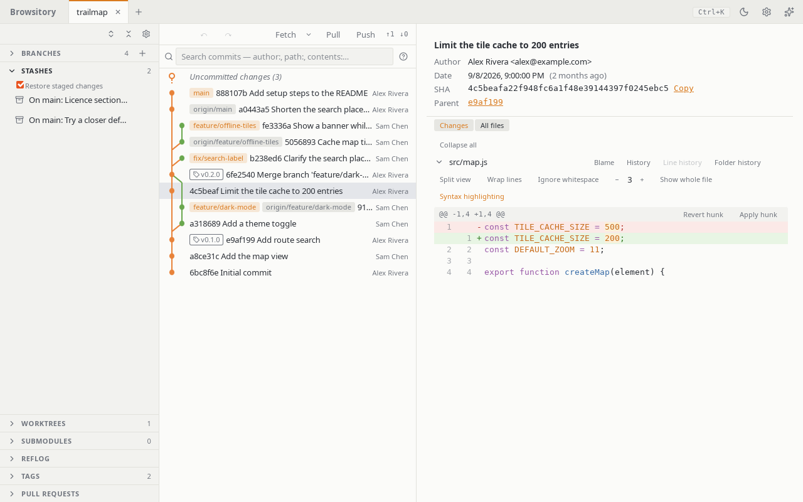

# Stashes

**Stash** in the commit dock sets every change aside, untracked files included. Its chevron
opens **Stash all** and **Stash…**, a dialog with an optional message, **Keep staged changes**
(stash them but also leave them staged) and **Include untracked files** (on by default).
**Stash file…** in a changed file's menu (staged or not) opens the same dialog for just that
file; every other change stays where it is, and "Restore staged changes" later restages only
that file. For an untracked file, untracked files are always included. For a staged rename it
stashes both names: the new file and the old name's deletion. If you made a new file at the old
name since, it refuses ("Can't stash 'new' on its own: it was renamed from 'old', and 'old'
exists again. Stash 'old' too, or move it first."); **Stash file…** on the old name stashes
both. On macOS, Windows or with `core.ignorecase`, **Stash file…** refuses a rename that
changes only the case of a name (`Old` to `old`); commit it or undo it first. One file at a
time: the change lists have no multi-select. A file inside a symlinked folder can't be stashed on its own.
If a tracked file was replaced by a symbolic link, stashing keeps the link in the stash and puts
the file back; while a symbolic link replaces a tracked folder, **Stash all** refuses (move the
link away first). So do switching branches, merging, cherry-picking, reverting, rebasing,
applying a stash and pulling, which could otherwise create files through the link — also when
nothing tracked the link's name but the operation would create files below it. The message names
the link: "'d' is a symbolic link where the repository has a folder. Remove or rename it first."
Staging a file below such a link stages its deletion (git sees no file there; nothing is read
through the link), and **Stage all** stages the link itself in place of the folder, in any order.
Unstaging the link or any of the folder's files puts the link and the folder's files back
together, since git's index can't hold half of the swap. The other way round works the same: when
a folder replaced a committed file or link, **Stage all** stages that file's deletion and the
folder's files in any order, and unstaging any of them, the folder's name included, puts the file
or link back. Unstaging a staged rename whose old path is part of such a swap leaves the swap
staged, as `git restore --staged` does. While a merge has left conflicts in such a swap,
unstaging it refuses and changes nothing ("Can't unstage 'd': the merge left conflicts in it.
Resolve them first."). Discarding a file below the link still refuses ("'d/f' is beyond a
symbolic link."), like git.

When a file replaced a tracked folder (`d` where `d/f` was), **Stash file…** on `d` stashes the
file together with the folder's deletion and puts the folder back, as `git stash push -u -- d`
does. Browsitory can't apply such a stash while the folder is back: Apply and Pop say "This stash
can't be applied here because a file replaced a folder; use git stash apply from a terminal."
and keep the stash. If a folder was created where a stash holds an untracked file, Apply and Pop
refuse too ("The untracked file 'd' in this stash would overwrite the folder 'd'; move the folder
first."). With **Include untracked files** off, stashing would delete an untracked file that is
in the way of a stashed folder or file (with **Keep staged changes** also one in the way of a
staged one), so it refuses instead ("Stashing would delete the untracked file 'd', which is in
the way of 'd/f'. Turn on Include untracked files, or move 'd' first."). Where names ignore case
(macOS, Windows, or `core.ignorecase` on Linux), `docs` counts as in the way of `Docs/f`, and so
does a name that differs only in Unicode form (`ss` in the way of `ß/f`).

Ignored files and repositories nested in the worktree are never stashed. If one is in the way of
a file or folder that stashing puts back, **Stash all** would delete it, as git does. So it
refuses, with or without **Include untracked files**, and stashes nothing: "Stashing would delete
the ignored 'd', which is in the way of the tracked 'd/f'. Move 'd' first." or "Stashing would
delete the repository in 'd', which is in the way of the tracked 'd'. Move 'd' first." Ignored
files and repositories elsewhere don't matter. A repository inside an untracked folder
(`vendor/lib` in a new `vendor/`) stays where it is, with its history, as with
`git stash -u`: **Stash all** sets aside the folder's other untracked files only. Ignored files
in an untracked folder stay too. In that case Stash all works like **Stash file…** on every
change, so it also refuses what that refuses. For example, a folder that replaced a tracked file
gets "Can't stash 'd': it was a file and is now a directory. Commit or move its contents first."
A file or folder you removed from the index and then ignored (`.env` after
`git rm --cached .env`, or `build/` after `git rm -r --cached build`) isn't stashed, and
stashing would overwrite it with the committed version. So **Stash all** and **Stash file…**
refuse, as git does: "Stashing would overwrite the ignored '.env' with its committed version.
Commit the removal of '.env' first, or move it."
A repository you staged inside this one (`git add lib`, where `lib` has its own `.git`) can't be
stashed. **Stash all**, and **Stash file…** on `lib`, refuse and change nothing: "'lib' is a
repository inside this one. Add it as a submodule or remove it from the index first." A
submodule you added but haven't committed yet gets "Can't stash the new submodule 'lib'. Commit
it first, or remove it from the index." If `lib` is gone, or has no `.git` any more, the message
asks you to remove `lib` from the index first. **Stash file…** on other files still works.
If you removed a file or folder from the index without ignoring it (`git rm -r --cached d`) and
then edited it, **Stash all** stashes your edit and puts the committed version back. **Pop**
brings the edit back; with **Restore staged changes** the removal from the index comes back too.
This is the same with **Stash file…**, and for a removal without an edit: the file is back in
the index afterwards, so Pop isn't refused. With **Keep staged changes** the file is deleted, as
with git; the edit is still in the stash. Pop works once you unstage that deletion and discard
it. This applies to any stash made with **Keep staged changes**: the staged changes are still
staged, so Pop says "Commit or unstage your staged changes before applying a stash." until you
commit or unstage them. In this case **Stash all** works like **Stash file…** on every change,
so it also refuses what that refuses. For example, if another tracked file `t` is now a folder,
it says "Can't stash 't': it was a file and is now a directory. Commit or move its contents
first."

While a merge or another operation has left conflicts, stashing refuses and changes nothing:
"Resolve the current conflicts before stashing." This applies to Stash all and Stash file… alike,
as with git.

When a folder replaced a tracked file (`d/x` where the file `d` was), **Stash all** with
untracked files stashes `d/x` and the deletion of `d`, and puts the file `d` back. Browsitory
can't apply such a stash while `d` is a tracked file, and neither can `git stash pop`. Apply and
Pop say "This stash can't be applied here: its untracked file 'd/x' needs a folder where 'd' is
tracked. Commit the deletion of 'd' first, then apply it; the stash is kept." The same
applies when a file `d` was committed after the stash was made. Once the deletion of `d` is
committed, the stash applies.

On macOS and Windows, where `D` and `d` name the same file, a commit that holds a symbolic link
and a folder whose names differ only in case (`D` and `d/x`) can't be checked out safely:
switching to it, merging, pulling, cherry-picking, rebasing, applying a stash, resetting,
undo/redo, cloning, adding a worktree or updating a submodule refuses ("'D' is a symbolic link
and 'd' a folder whose names differ only in case…"). Rename one of them in the repository (on
Linux, or with git). On Linux this only applies when `core.ignorecase` is set, or, when adding a
worktree, when the worktree's drive or folder ignores case (a USB stick, a case-insensitive
folder). `ẞ`, `ß` and `ss` count as the same name, and so do names that differ only in how an
accent is encoded (`é` as one or two code points).

Expand **Stashes** to see everything set aside. Click a stash to see what it holds: **Changes**
(diffed against the commit it was made on) and, if it took any, **Untracked** files. From there
or from the panel you can **Apply** it (keep the stash), **Pop** it (apply, then drop it) or
drop it (**Drop…**). In the panel these are menu items in the stash's menu: open it with the
**…** button that shows when you point at or tab to the stash, by right-clicking the stash, or
with the Menu key or Shift+F10. Hover over a long stash name to read all of it. **Restore staged
changes** (on by default) brings back staged work as staged; turn it off to get everything back
unstaged.

Apply and Pop need nothing staged and no unresolved conflicts; the buttons and menu items are
disabled with the reason until then. A stash that conflicts with your current files applies anyway and opens the
files in the conflict pane; a conflicting **Pop** keeps the stash, so drop it yourself once the
files are resolved. If the stash list changed since you looked (another tool stashed or
dropped), Apply, Pop and Drop stop and ask you to refresh. Dropping asks for confirmation first, since it can't be undone, and stash
operations are not part of **Undo**.
