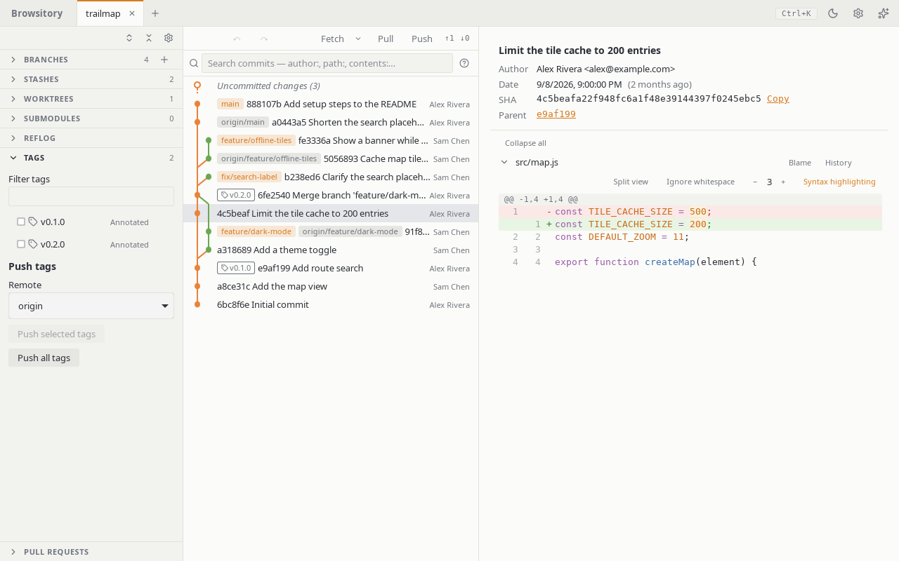

# Tags

## Create a tag

Tag any commit from the graph: right-click its row (or select it and press Enter, the Menu key or
Shift+F10) and choose **Create tag…**. The dialog shows the commit the tag goes on. Give the tag
a name (a name git can't use, or one another tag already has, is pointed out under the field), pick
**Lightweight tag** or **Annotated tag** (an annotated tag needs a message), and
tick **Push the tag after creating it** to send it to a remote right away (pick the remote when
there are several). The **+** button in the Tags panel's header and **Create tag at HEAD…** in
the command palette tag the commit you have checked out, and **Create tag at ⟨commit⟩…** tags the commit selected in the graph. Undo removes
a tag you just created.

## The Tags panel

Open **Tags** in the sidebar for the list of every local tag, including tags on commits the graph
doesn't show, one line per tag with its kind (annotated or lightweight). Type in **Filter tags**
to find a tag by name. Click a tag, or press Enter or Space on it, to select its commit and
scroll the graph there, without checking anything out (**Go to tag…** in the command palette does
the same; see [Command palette](command-palette.md#go-to-a-commit-branch-tag-or-stash) for what
happens when the graph doesn't show the commit). To share tags, tick the ones you want (**Select
all** over the list ticks every tag the filter shows): a bar under the list says how many are
selected and pushes them: **Push to ⟨remote⟩**, or, with several remotes, pick one and choose
**Push**. **Clear selection** unticks them. To push one tag, use **Push ⟨tag⟩ to ⟨remote⟩** in its
menu; **Push all tags to ⟨remote⟩** in the command palette pushes every tag. A tag's other actions are in its menu: the **…** button (it appears when you point at or tab into
the row), a right-click, or the Menu key or Shift+F10 on the row, its checkbox or its **…**. The menu has the same items as the tag's
badge in the graph: push to a remote, **Branch from tag**, **Checkout (detached)**, **Copy tag
name**, **Delete from remote…** and **Delete tag…** (the local tag, after a confirmation).

## Delete a tag on a remote

**Delete from remote…** removes a tag that is already on a remote, like
`git push <remote> --delete <tag>`. Pick the remote when there are several. Tick **Also delete
the local tag** to delete your own copy too; it is deleted only once the remote delete has
worked. The remote delete can't be undone (Undo only brings back the local tag). It runs the
`pre-push` hook and uses the remote's credentials, like a push. The command palette has **Delete
tag ⟨tag⟩ from remote…** for each tag.

## Tags in the graph

Tags appear as outlined badges (with a tag icon) on commit rows in the graph, file history and
search results. Right-click a badge in the graph to push that tag to a remote, create a branch
from it (**Branch from tag**), check out its commit (detached), delete the tag on a remote, or
delete the local tag. The Tags panel remains the keyboard path for pushing and deleting tags;
**Check out tag … (detached)** in the command palette checks out a tag's commit.

<!-- CI proof: docs-only change (throwaway, do not merge). -->
