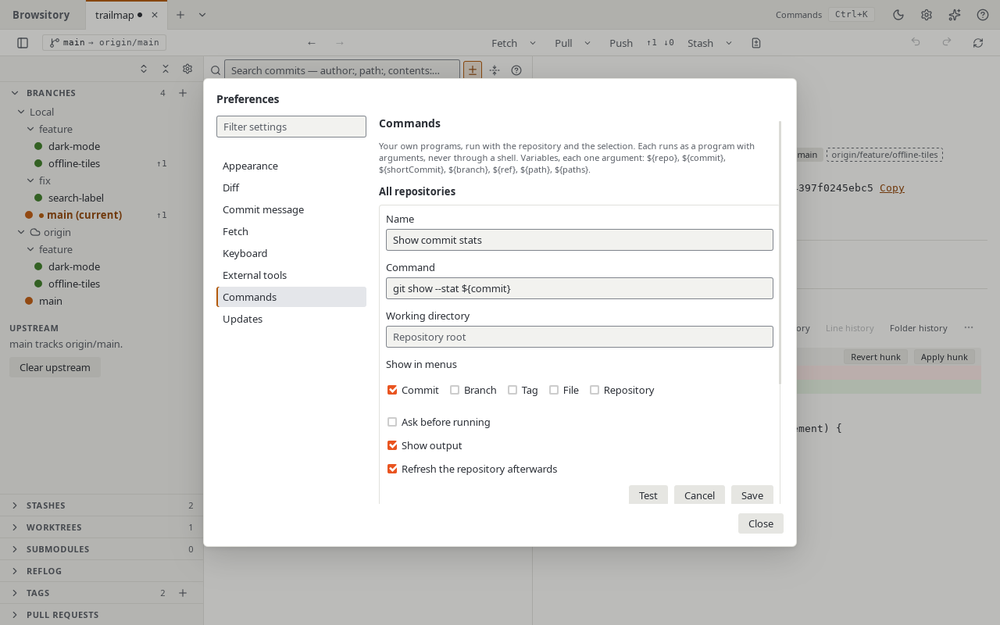

# Your own commands

Add your own programs to Browsitory's menus and to the command palette, run with the
repository and what you selected: a commit, a branch, a tag or files.

## Adding a command

Open **Preferences → Commands** (the gear button in the header, or "Preferences…" in the
palette). The group has two lists:

- **All repositories**: the command is offered in every repository.
- **Only in** *repository*: the command is offered in the active repository only.

Click **Add command** under the list you want, then fill in:

- **Name**: what the menus and the palette show.
- **Command**: the program and its arguments, with variables (below).
- **Working directory**: where the program runs. Leave it empty for the repository's root
  folder; a relative folder is below the root, and `${repo}` works here too.
- **Show in menus**: the commit, branch, tag, file and repository menus it appears in. Every
  command is in the palette as "Run: *name*" whatever you pick here.
- **Ask before running**, **Show output** and **Refresh the repository afterwards**.

**Test** shows how Browsitory splits the command into arguments and where it found the program,
without running anything. **Save** checks the command first and says what is wrong with one it
can't run, such as an unknown variable. Use the arrows to change the order the menus and the
palette list your commands in, and **Delete** to remove one.



## Variables

| Variable | Stands for |
|---|---|
| `${repo}` | The repository's root folder |
| `${commit}` | The commit's full id |
| `${shortCommit}` | The commit's short id |
| `${branch}` | The branch's name, such as `main` or `origin/main` |
| `${ref}` | The branch's or tag's full name, such as `refs/heads/main` or `refs/tags/v1.0` |
| `${path}` | The selected file's full path (one file) |
| `${paths}` | The selected files' full paths, one argument each |

A branch or a tag also stands for its commit, so `${commit}` works in the branch and tag menus.
In the palette, `${commit}` is the commit selected in the history, `${branch}` the current branch
and `${paths}` the selected changed files (or the one shown). A command whose variables can't be
filled where it is offered is greyed out, with the reason.

## Examples

```text
git show --stat ${commit}
code --diff ${path} ${repo}/README.md
npx prettier --check ${paths}
gh pr create --head ${branch}
${repo}/scripts/release-notes.sh ${ref}
```

## How a command runs

The command line is split into words the way a shell would, and each variable is replaced
inside its word. The command never runs through a shell, and a value is always exactly one
argument: a branch or file name with spaces, quotes or `$(…)` in it can't add or change
arguments. `${paths}` must be a word of its own and becomes one argument per file.

The program is looked up on your `PATH`, or given by its full path (`${repo}/scripts/x.sh` is
one). Browsitory never runs a program from the current folder, so `./script.sh` is refused.

With **Show output** on, a window shows the command's output while it runs, with **Stop**; with
it off, a message says when it is done, and offers **Show output** if it failed. Each run is
also in the [operation log](operation-log.md); there, **Run again** on a failed run runs the
same command on the same selection. A command that runs longer than 30 minutes is stopped.

??? note "Details"
    - Output keeps the last 256 KiB of what the program wrote to its standard output and error.
    - To write a literal `${`, write `$${`. Any other `$` is an ordinary character, so a shell
      variable reaches a shell you start yourself unchanged, as in
      `sh -c 'echo "$1"' sh ${branch}`.
    - Apps started from the macOS Dock or a Linux desktop launcher may not see your shell's
      `PATH`: give the program's full path if it isn't found ("Test" says so).
    - On Windows the program is looked up with `PATHEXT`, so `tool` finds `tool.exe` or
      `tool.cmd`, and no console window opens.

## Safety

Commands are kept in Browsitory's own settings, never in a file inside a repository, so cloning
a repository can't add a command or change one. A command runs only when you pick it.

In VS Code, your commands run only in a trusted workspace. In Restricted Mode they are left out
of the menus, and the palette lists them as unavailable, saying why.
