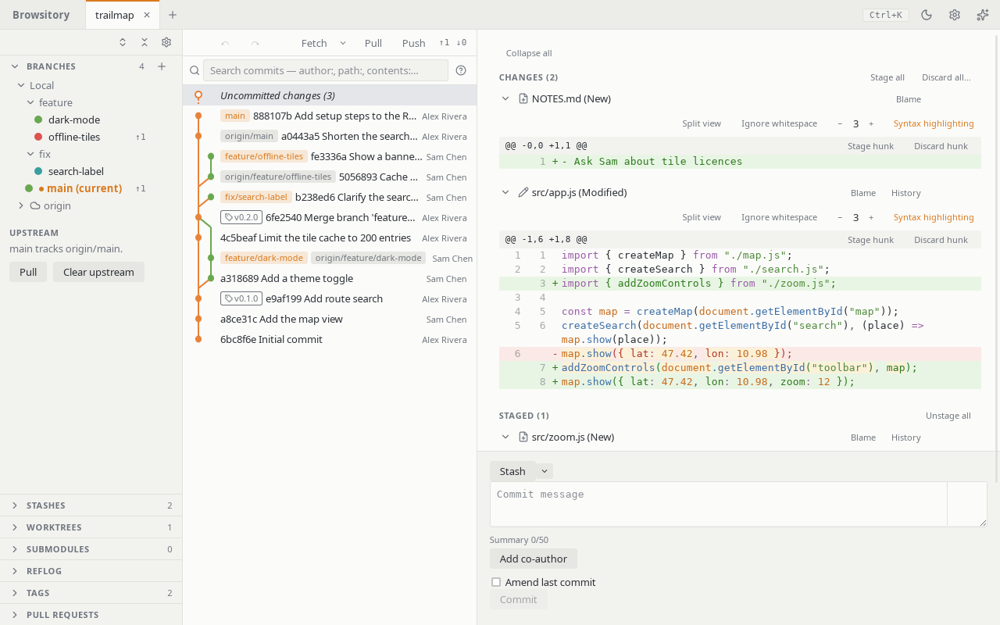
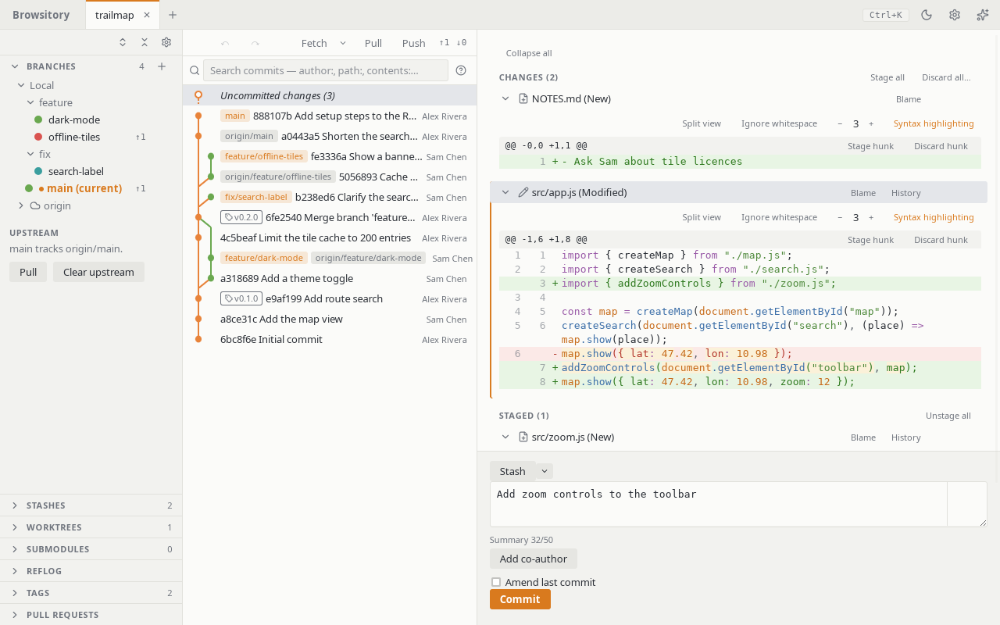
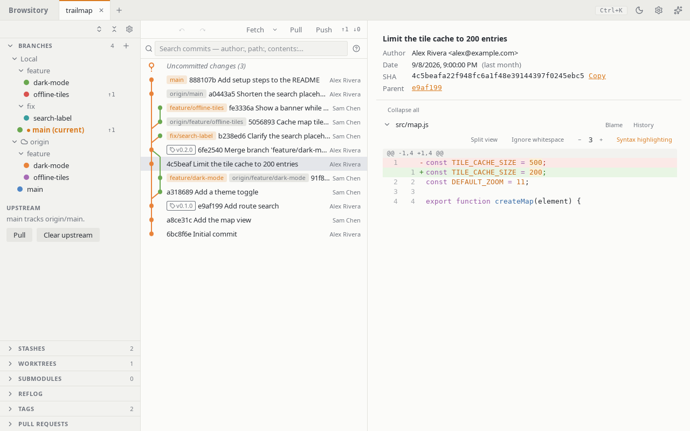

# Browsitory for VSCode

A full Git client in a VSCode editor tab. Browsitory shows your history as a commit graph and
lets you stage, commit, branch, rebase, stash and tag without leaving the editor. It is the
same app as the [Browsitory desktop client](https://github.com/rene-langer/browsitory), running
inside VSCode.

> **Pre-release.** Browsitory is published as a pre-release for now. In the Extensions view,
> pick **Switch to Pre-Release Version** (or **Install Pre-Release Version**) to get it.
> Please report problems on [GitHub](https://github.com/rene-langer/browsitory/issues).



## Features

- **Commit graph.** Browse history newest first, with branches and tags on their commits.
  Search commits, compare two commits or branches, and follow one file's history.
- **Staging and committing.** Stage whole files, single hunks or single lines. Discard or
  ignore files. Amend, sign commits, and run your commit hooks.
- **Branches and remotes.** Create, check out, rename, merge and delete branches. Fetch,
  pull and push. Set upstreams and manage remotes.
- **Rebase and history rewriting.** Rebase, cherry-pick, revert, reword, squash and reorder
  commits. Resolve conflicts in VSCode's own merge editor.
- **Stashes, tags, worktrees and submodules**, each in its own sidebar section.
- **Pull requests** for GitHub and Bitbucket remotes: list them and open new ones.
- **Undo and redo** for many Git actions, and a reflog view.
- **Command palette** (Ctrl+K, or Cmd+K on macOS) with every action, and keyboard shortcuts
  for the rest.
- **VSCode integration.** Files open in VSCode's editor, diffs in its diff view, conflicts in
  its merge editor, and terminals in its integrated terminal.





## Getting started

1. Install Browsitory from the Extensions view.
2. Run **Browsitory: Open** from the Command Palette (Ctrl+Shift+P, or Cmd+Shift+P on macOS).
3. Pick a repository folder.

To clone or create a repository, use VSCode's own **Git: Clone** and **Git: Initialize
Repository**, then open it in Browsitory.

The [User Guide](https://github.com/rene-langer/browsitory/blob/main/docs/USER_GUIDE.md)
describes every feature.

## Requirements

- VSCode 1.134 or newer, on desktop.
- One of these platforms: Linux x64, macOS (Intel or Apple silicon), Windows x64. Each
  platform gets its own package with a matching native helper program, so you don't need Git
  or any other tool installed.
- Browsitory does not run in vscode.dev or GitHub Codespaces in the browser.

## Install from a VSIX file

Each [GitHub release](https://github.com/rene-langer/browsitory/releases) also has one
`.vsix` file per platform. Download the one for your platform and run:

```sh
code --install-extension browsitory-<version>-<platform>.vsix
```

## Licence

Browsitory is MIT-licensed. The native helper program links libgit2 (GPL-2.0 with a linking
exception) and other libraries; see `THIRD_PARTY_NOTICES.md` in the package. Source code:
<https://github.com/rene-langer/browsitory>.
